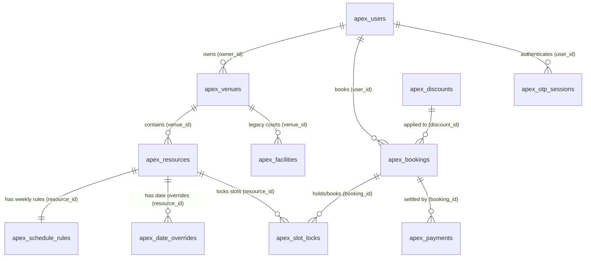

# Data Model Specification: Project Apex (Neon Serverless PostgreSQL)

**Mission Slug:** `001-project-apex-mvp` (Stage 1 — 3-Tier Persistence Upgrade)  
**Architecture:** Tier 1 (Firebase Hosting PWA) $\leftrightarrow$ Tier 2 (Render Java 21 / Spring Boot) $\leftrightarrow$ Tier 3 (Neon Serverless PostgreSQL)  
**Governing Agent:** `apex-db` (Database Expert)  
**DDL Source of Truth:** [`backend/src/main/resources/db/schema.sql`](backend/src/main/resources/db/schema.sql)  
**Status:** Verified for Neon PostgreSQL 15/16 & H2 PostgreSQL Compatibility Mode

---

## 1. Architecture & Persistence Overview

Project Apex migrates persistence from the earlier 8-collection Cloud Firestore / in-memory `FirebaseService` store to a **13-table relational schema** on **Neon Serverless PostgreSQL (PG 15/16)**, while maintaining 100% DDL compatibility with **H2 in PostgreSQL mode** (`MODE=PostgreSQL;DATABASE_TO_LOWER=TRUE`) for fast, isolated Spring Boot test execution.

### 1.1 Key Design Conventions
- **Currency Integrity (`BIGINT` Paise):** Every monetary field is stored as a signed 64-bit integer (`BIGINT`) in **paise** (`INR * 100`), eliminating floating-point rounding discrepancies and aligning directly with the Razorpay Orders/Refunds API (`amount_paise`, `base_price_paise`, `subtotal_paise`, `final_payable_paise`, `refund_amount_paise`). Legacy INR compatibility fields (`FacilityRecord.baseHourlyRate` / `peakHourlyRate` and `TransactionRecord.amount`) map to paise (`rate * 100`).
- **Epoch Timestamps (`BIGINT` Milliseconds):** All timestamps and lease expirations (`created_at`, `updated_at`, `expires_at`, `hold_expires_at`, `acquired_at`, `received_at`, `verified_at`, `valid_from`, `valid_until`) are stored as UTC epoch milliseconds (`BIGINT`), matching Java `System.currentTimeMillis()` and `long`/`Long` model properties directly.
- **Cross-Engine JSON Serialization (`TEXT`):** Nested lists and maps (`slots_json`, `weekly_schedule_json`, `blocked_slots_json`, `cancellation_policy_json`, `amenities_json`, `metadata_json`, etc.) are stored in standard `TEXT` columns as UTF-8 JSON rather than PostgreSQL-specific `JSONB` or `TEXT[]` arrays, avoiding H2 JDBC binding divergences and PostgreSQL-only extension requirements (`uuid-ossp`, `pgcrypto`, `GIN`).
- **Idempotent Startup DDL:** `schema.sql` uses exclusively `CREATE TABLE IF NOT EXISTS` and `CREATE INDEX IF NOT EXISTS` without `DROP TABLE` or `TRUNCATE`, making startup schema initialization safe across repeated Render container restarts and Neon deployments.
- **Decoupled Entity References:** Indexed identifier columns (`user_id`, `owner_id`, `venue_id`, `resource_id`, `booking_id`) are retained without rigid foreign-key constraints so compatibility workflows (`TechSpecWorkflowsTest`, `BackendApplicationTests`, walk-in bookings, and unauthenticated seed fixtures) execute cleanly without referential breakage, while critical concurrency invariants are enforced via explicit `UNIQUE` constraints.

---

## 2. Mapping: 8-Collection Firestore / In-Memory Design $\rightarrow$ 13 Neon PostgreSQL Tables

| Earlier Firestore Collection / `FirebaseService` Map | Java Domain Model(s) | Neon PostgreSQL Table(s) | Migration & Mapping Notes |
| :--- | :--- | :--- | :--- |
| `users` | `UserRecord`, `OwnerProfile` | `apex_users` | Embedded `OwnerProfile` fields flattened into `owner_*` columns plus optional `owner_profile_json` backup. |
| `venues` | `VenueRecord` | `apex_venues` | `amenities`, `sportTypes`, `imageUrls`, `cancellationPolicy` serialized into `*_json TEXT` columns. |
| *(in-memory `resources`)* | `ResourceRecord` | `apex_resources` | Primary playable unit catalog (turfs, courts, tables) with weekday, weekend, and peak pricing in paise. |
| *(in-memory `scheduleRules`)* | `ScheduleRuleRecord` | `apex_schedule_rules` | Weekly open/close hours and peak windows stored per `resource_id` in `weekly_schedule_json`. |
| *(in-memory `dateOverrides`)* | `DateOverrideRecord`, `AvailabilityDoc` | `apex_date_overrides` | Per-date closures, custom hours, blocked slots, and price overrides (`uq_apex_date_override`); replaces Firestore's pre-generated `availability` docs. |
| `availability` *(legacy daily doc)* | `AvailabilityDoc`, `SlotInfo` | Derived *(+ `apex_facilities` / `apex_date_overrides`)* | Slots are computed dynamically by `CalendarAvailabilityService` from `apex_schedule_rules`, `apex_date_overrides`, and `apex_slot_locks` (zero empty-slot pre-generation). Optional `slots_snapshot_json` on `apex_date_overrides` supports legacy snapshots if needed. |
| `concurrency_locks` *(+ `slotLocks`)* | `SlotLockRecord`, `ConcurrencyLock` | `apex_slot_locks` | Unified lock table enforcing `CONSTRAINT uq_apex_slot_lock UNIQUE (resource_id, booking_date, start_time)` across all Render instances. |
| *(in-memory `discounts`)* | `DiscountRecord` | `apex_discounts` | Supports `PROMO_CODE`, `OFF_PEAK_AUTO`, and `BULK_SLOTS_AUTO` rules with JSON scope filters. |
| `bookings` | `BookingRecord`, `BookedSlotItem` | `apex_bookings` | Itemized booked slots persisted in `slots_json`; indexed on `user_id`, `owner_id`, `venue_id`, `booking_code`, `(resource_id, booking_date)`, `status`, and `razorpay_order_id`. |
| `transactions` *(+ `payments`)* | `PaymentRecord`, `TransactionRecord` | `apex_payments` | Unified financial ledger covering Razorpay payments, refunds, and offline cash collections in `amount_paise`. |
| *(in-memory `otpVerifications`)* | `OtpSession` | `apex_otp_sessions` | Stores dual registration OTPs (`phone_otp`, `email_otp`) and `login_otp` with TTL (`expires_at`) and retry counters. |
| *(in-memory `webhookEvents`)* | `WebhookEventRecord` | `apex_webhook_events` | Idempotent Razorpay webhook deduplication keyed by `event_id` PK. |
| `courts` | `FacilityRecord` | `apex_facilities` | Legacy compatibility facility/court catalog; INR rates stored as paise (`base_hourly_rate_paise`, `peak_hourly_rate_paise`). |
| `audit_logs` | `AuditLog` | `apex_audit_logs` | Append-only security and state-transition audit trail with `metadata_json` and epoch `created_at`. |

---

## 3. ACID Double-Booking Prevention (`apex_slot_locks`)

In a multi-instance Render deployment, in-memory `synchronized` blocks alone cannot prevent two concurrent HTTP requests on separate JVM instances from reserving the same slot simultaneously.

`apex_slot_locks` enforces atomicity at the PostgreSQL database engine level via:

```sql
CONSTRAINT uq_apex_slot_lock UNIQUE (resource_id, booking_date, start_time)
```

### Lock Lifecycle & Conflict Handling
1. **Acquire Hold (`HELD`):** Inside a database transaction, the backend cleans up or overwrites any expired (`hold_expires_at < now`) or `RELEASED` lock row for `(resource_id, booking_date, start_time)` and inserts/claims the row with `status = 'HELD'` and `hold_expires_at = now + ttlMs`.
2. **Concurrent Contention (`SQLState 23505`):** If two Render instances race to insert `(res_thane_crk_01, '2026-11-30', '19:00')` simultaneously, PostgreSQL's unique index on `uq_apex_slot_lock` allows exactly one transaction to succeed and rejects the losing transaction with `SQLState 23505` (`unique_violation`), which maps cleanly to HTTP `409 Conflict`.
3. **Payment Commit (`BOOKED`):** Upon Razorpay HMAC signature verification (`/verify-payment`) or asynchronous webhook confirmation (`order.paid` / `payment.captured`), the lock row transitions atomically within the booking transaction to `status = 'BOOKED'` with `hold_expires_at = NULL`.
4. **Release / Expiry:** Cancellations, payment failures, or `BookingHoldExpiryScheduler` sweeps remove or release only rows matching `booking_id` and `status = 'HELD'`, freeing the `(resource_id, booking_date, start_time)` tuple for subsequent players.

---

## 4. HikariCP Connection Pool Sizing (Neon Free Tier)

Neon Serverless PostgreSQL Free Tier allocates shared compute (0.25–2 CU) that **scales to zero after inactivity** (~5 minutes) and imposes strict concurrent connection and cold-start characteristics. Configure HikariCP on Spring Boot (`spring.datasource.hikari.*`) with the following parameters:

| HikariCP / JDBC Property | Recommended Value | Rationale for Neon Free Tier + Render |
| :--- | :--- | :--- |
| `maximumPoolSize` | `5` | Prevents connection saturation across Render web instances while staying comfortably within Neon Free Tier compute connection limits. |
| `minimumIdle` | `1` | Keeps pool footprint minimal so Neon compute can suspend cleanly during idle windows instead of holding idle slots open. |
| `idleTimeout` | `300000` (5 min) | Evicts excess idle connections promptly prior to or aligned with Neon's auto-suspend window. |
| `maxLifetime` | `600000` (10 min) | Recycles pooled connections regularly to avoid stale/dropped TCP sockets across Neon compute restarts and PgBouncer transitions. |
| `connectionTimeout` | `30000` (30 sec) | Gives Neon serverless compute sufficient headroom (1–3s typical wake-up) to resume from scale-to-zero without failing requests. |
| JDBC `sslmode` | `require` | Enforces TLS encryption between Render Spring Boot and Neon (`jdbc:postgresql://<host>/<db>?sslmode=require`). |

**Test / Local Profile (H2 PostgreSQL Mode):**
```properties
jdbc:h2:mem:apexdb;MODE=PostgreSQL;DATABASE_TO_LOWER=TRUE;DB_CLOSE_DELAY=-1
```

---

## 5. Entity-Relationship Overview



---

## 6. Complete Relational Table & Index Specifications (13 Tables)

### 6.1 `apex_users`
**Java Models:** `UserRecord`, `OwnerProfile`

| Column | SQL Type | Constraints / Default | Java Field Mapping |
| :--- | :--- | :--- | :--- |
| `uid` | `VARCHAR(255)` | `PRIMARY KEY` | `UserRecord.uid` |
| `email` | `VARCHAR(255)` | Nullable | `UserRecord.email` |
| `full_name` | `VARCHAR(255)` | `NOT NULL` | `UserRecord.fullName` (`displayName`) |
| `phone` | `VARCHAR(64)` | Nullable | `UserRecord.phone` |
| `role` | `VARCHAR(64)` | `NOT NULL DEFAULT 'ROLE_PLAYER'` | `UserRecord.role` |
| `city` | `VARCHAR(128)` | `DEFAULT 'Thane'` | `UserRecord.city` |
| `preferred_sports_json` | `TEXT` | Nullable | `UserRecord.preferredSports` (JSON array) |
| `owner_business_name` | `VARCHAR(255)` | Nullable | `OwnerProfile.businessName` |
| `owner_business_address` | `TEXT` | Nullable | `OwnerProfile.businessAddress` |
| `owner_gst_number` | `VARCHAR(64)` | Nullable | `OwnerProfile.gstNumber` |
| `owner_pan_number` | `VARCHAR(32)` | Nullable | `OwnerProfile.panNumber` |
| `owner_verification_status` | `VARCHAR(64)` | Nullable | `OwnerProfile.verificationStatus` |
| `owner_verified_at` | `BIGINT` | Nullable | `OwnerProfile.verifiedAt` |
| `owner_payout_upi_or_bank_mask` | `VARCHAR(255)` | Nullable | `OwnerProfile.payoutUpiOrBankMask` |
| `owner_profile_json` | `TEXT` | Nullable | `UserRecord.ownerProfile` (JSON backup) |
| `password_hash` | `VARCHAR(255)` | Nullable | `UserRecord.passwordHash` |
| `loyalty_points` | `BIGINT` | `NOT NULL DEFAULT 100` | `UserRecord.loyaltyPoints` |
| `is_phone_verified` | `BOOLEAN` | `NOT NULL DEFAULT TRUE` | `UserRecord.isPhoneVerified` |
| `is_email_verified` | `BOOLEAN` | `NOT NULL DEFAULT TRUE` | `UserRecord.isEmailVerified` |
| `created_at` | `BIGINT` | `NOT NULL` | `UserRecord.createdAt` |
| `updated_at` | `BIGINT` | `NOT NULL` | `UserRecord.updatedAt` |

**Indexes:** `idx_apex_users_email (email)`, `idx_apex_users_phone (phone)`, `idx_apex_users_city (city)`, `idx_apex_users_role (role)`, `idx_apex_users_owner_verif (owner_verification_status)`

---

### 6.2 `apex_venues`
**Java Model:** `VenueRecord`

| Column | SQL Type | Constraints / Default | Java Field Mapping |
| :--- | :--- | :--- | :--- |
| `venue_id` | `VARCHAR(255)` | `PRIMARY KEY` | `VenueRecord.venueId` |
| `owner_id` | `VARCHAR(255)` | `NOT NULL` | `VenueRecord.ownerId` |
| `name` | `VARCHAR(255)` | `NOT NULL` | `VenueRecord.name` |
| `description` | `TEXT` | Nullable | `VenueRecord.description` |
| `address_line` | `TEXT` | Nullable | `VenueRecord.addressLine` |
| `locality` | `VARCHAR(255)` | Nullable | `VenueRecord.locality` |
| `city` | `VARCHAR(128)` | `NOT NULL` | `VenueRecord.city` |
| `state` | `VARCHAR(128)` | `DEFAULT 'Maharashtra'` | `VenueRecord.state` |
| `pincode` | `VARCHAR(16)` | `DEFAULT '400601'` | `VenueRecord.pincode` |
| `latitude` | `DOUBLE PRECISION` | `NOT NULL DEFAULT 19.2183` | `VenueRecord.latitude` |
| `longitude` | `DOUBLE PRECISION` | `NOT NULL DEFAULT 72.9781` | `VenueRecord.longitude` |
| `contact_phone` | `VARCHAR(64)` | Nullable | `VenueRecord.contactPhone` |
| `amenities_json` | `TEXT` | Nullable | `VenueRecord.amenities` |
| `sport_types_json` | `TEXT` | Nullable | `VenueRecord.sportTypes` |
| `min_slot_price_paise` | `BIGINT` | `NOT NULL DEFAULT 80000` | `VenueRecord.minSlotPricePaise` |
| `has_active_discounts` | `BOOLEAN` | `NOT NULL DEFAULT TRUE` | `VenueRecord.hasActiveDiscounts` |
| `image_urls_json` | `TEXT` | Nullable | `VenueRecord.imageUrls` |
| `cancellation_policy_json` | `TEXT` | Nullable | `VenueRecord.cancellationPolicy` |
| `status` | `VARCHAR(32)` | `NOT NULL DEFAULT 'ACTIVE'` | `VenueRecord.status` |
| `rating` | `DOUBLE PRECISION` | `NOT NULL DEFAULT 4.8` | `VenueRecord.rating` |
| `review_count` | `INTEGER` | `NOT NULL DEFAULT 142` | `VenueRecord.reviewCount` |
| `created_at` | `BIGINT` | `NOT NULL` | `VenueRecord.createdAt` |
| `updated_at` | `BIGINT` | `NOT NULL` | `VenueRecord.updatedAt` |

**Indexes:** `idx_apex_venues_city (city)`, `idx_apex_venues_owner_id (owner_id)`, `idx_apex_venues_status (status)`, `idx_apex_venues_city_status (city, status)`

---

### 6.3 `apex_resources`
**Java Model:** `ResourceRecord`

| Column | SQL Type | Constraints / Default | Java Field Mapping |
| :--- | :--- | :--- | :--- |
| `resource_id` | `VARCHAR(255)` | `PRIMARY KEY` | `ResourceRecord.resourceId` |
| `venue_id` | `VARCHAR(255)` | `NOT NULL` | `ResourceRecord.venueId` |
| `owner_id` | `VARCHAR(255)` | `NOT NULL` | `ResourceRecord.ownerId` |
| `name` | `VARCHAR(255)` | `NOT NULL` | `ResourceRecord.name` |
| `sport_types_json` | `TEXT` | Nullable | `ResourceRecord.sportTypes` |
| `slot_duration_minutes` | `INTEGER` | `NOT NULL DEFAULT 60` | `ResourceRecord.slotDurationMinutes` |
| `base_price_paise` | `BIGINT` | `NOT NULL DEFAULT 100000` | `ResourceRecord.basePricePaise` |
| `weekend_price_paise` | `BIGINT` | `NOT NULL DEFAULT 140000` | `ResourceRecord.weekendPricePaise` |
| `peak_hour_price_paise` | `BIGINT` | `NOT NULL DEFAULT 130000` | `ResourceRecord.peakHourPricePaise` |
| `max_players` | `INTEGER` | `NOT NULL DEFAULT 14` | `ResourceRecord.maxPlayers` |
| `surface_type` | `VARCHAR(64)` | `DEFAULT 'ARTIFICIAL_TURF'` | `ResourceRecord.surfaceType` |
| `is_indoor` | `BOOLEAN` | `NOT NULL DEFAULT FALSE` | `ResourceRecord.isIndoor` |
| `is_active` | `BOOLEAN` | `NOT NULL DEFAULT TRUE` | `ResourceRecord.isActive` |
| `created_at` | `BIGINT` | `NOT NULL` | `ResourceRecord.createdAt` |
| `updated_at` | `BIGINT` | `NOT NULL` | `ResourceRecord.updatedAt` |

**Indexes:** `idx_apex_resources_venue_id (venue_id)`, `idx_apex_resources_owner_id (owner_id)`, `idx_apex_resources_active (venue_id, is_active)`

---

### 6.4 `apex_schedule_rules`
**Java Model:** `ScheduleRuleRecord`

| Column | SQL Type | Constraints / Default | Java Field Mapping |
| :--- | :--- | :--- | :--- |
| `resource_id` | `VARCHAR(255)` | `PRIMARY KEY` | `ScheduleRuleRecord.resourceId` |
| `venue_id` | `VARCHAR(255)` | `NOT NULL` | `ScheduleRuleRecord.venueId` |
| `owner_id` | `VARCHAR(255)` | `NOT NULL` | `ScheduleRuleRecord.ownerId` |
| `timezone` | `VARCHAR(64)` | `NOT NULL DEFAULT 'Asia/Kolkata'` | `ScheduleRuleRecord.timezone` |
| `weekly_schedule_json` | `TEXT` | `NOT NULL` | `ScheduleRuleRecord.weeklySchedule` |
| `updated_at` | `BIGINT` | `NOT NULL` | `ScheduleRuleRecord.updatedAt` |

**Indexes:** `idx_apex_schedule_rules_venue_id (venue_id)`, `idx_apex_schedule_rules_owner_id (owner_id)`

---

### 6.5 `apex_date_overrides`
**Java Models:** `DateOverrideRecord` (+ optional `AvailabilityDoc` snapshot)

| Column | SQL Type | Constraints / Default | Java Field Mapping |
| :--- | :--- | :--- | :--- |
| `override_id` | `VARCHAR(255)` | `PRIMARY KEY` | `DateOverrideRecord.overrideId` |
| `resource_id` | `VARCHAR(255)` | `NOT NULL` | `DateOverrideRecord.resourceId` |
| `venue_id` | `VARCHAR(255)` | `NOT NULL` | `DateOverrideRecord.venueId` |
| `override_date` | `VARCHAR(32)` | `NOT NULL` | `DateOverrideRecord.date` (`YYYY-MM-DD`) |
| `is_closed_full_day` | `BOOLEAN` | `NOT NULL DEFAULT FALSE` | `DateOverrideRecord.isClosedFullDay` |
| `closure_reason` | `TEXT` | Nullable | `DateOverrideRecord.closureReason` |
| `custom_open_time` | `VARCHAR(16)` | Nullable | `DateOverrideRecord.customOpenTime` |
| `custom_close_time` | `VARCHAR(16)` | Nullable | `DateOverrideRecord.customCloseTime` |
| `blocked_slots_json` | `TEXT` | Nullable | `DateOverrideRecord.blockedSlots` |
| `slot_price_overrides_json` | `TEXT` | Nullable | `DateOverrideRecord.slotPriceOverrides` |
| `slots_snapshot_json` | `TEXT` | Nullable | Optional `AvailabilityDoc.slots` snapshot |
| `updated_at` | `BIGINT` | `NOT NULL` | `DateOverrideRecord.updatedAt` |

**Unique Constraint:** `uq_apex_date_override UNIQUE (resource_id, override_date)`  
**Indexes:** `idx_apex_date_overrides_venue_id (venue_id)`, `idx_apex_date_overrides_res_date (resource_id, override_date)`

---

### 6.6 `apex_slot_locks`
**Java Models:** `SlotLockRecord`, `ConcurrencyLock`

| Column | SQL Type | Constraints / Default | Java Field Mapping |
| :--- | :--- | :--- | :--- |
| `lock_id` | `VARCHAR(255)` | `PRIMARY KEY` | `SlotLockRecord.lockId` / `ConcurrencyLock.lockKey` |
| `resource_id` | `VARCHAR(255)` | `NOT NULL` | `SlotLockRecord.resourceId` / `ConcurrencyLock.courtId` |
| `venue_id` | `VARCHAR(255)` | Nullable | `SlotLockRecord.venueId` |
| `booking_date` | `VARCHAR(32)` | `NOT NULL` | `SlotLockRecord.date` / `ConcurrencyLock.date` |
| `start_time` | `VARCHAR(16)` | `NOT NULL` | `SlotLockRecord.startTime` / `ConcurrencyLock.slot` |
| `end_time` | `VARCHAR(16)` | Nullable | `SlotLockRecord.endTime` |
| `status` | `VARCHAR(32)` | `NOT NULL DEFAULT 'HELD'` | `status` (`HELD`, `BOOKED`, `COMMITTED`, `RELEASED`, `EXPIRED`) |
| `booking_id` | `VARCHAR(255)` | Nullable | `SlotLockRecord.bookingId` / `ConcurrencyLock.bookingId` |
| `user_id` | `VARCHAR(255)` | `NOT NULL` | `SlotLockRecord.userId` / `ConcurrencyLock.userId` |
| `hold_expires_at` | `BIGINT` | Nullable | `SlotLockRecord.holdExpiresAt` / `ConcurrencyLock.expiresAt` |
| `acquired_at` | `BIGINT` | Nullable | `ConcurrencyLock.acquiredAt` |
| `created_at` | `BIGINT` | `NOT NULL` | `SlotLockRecord.createdAt` |

**ACID Constraint:** `CONSTRAINT uq_apex_slot_lock UNIQUE (resource_id, booking_date, start_time)`  
**Indexes:** `idx_apex_slot_locks_res_date (resource_id, booking_date)`, `idx_apex_slot_locks_venue_id (venue_id)`, `idx_apex_slot_locks_booking_id (booking_id)`, `idx_apex_slot_locks_user_id (user_id)`, `idx_apex_slot_locks_status_exp (status, hold_expires_at)`

---

### 6.7 `apex_discounts`
**Java Model:** `DiscountRecord`

| Column | SQL Type | Constraints / Default | Java Field Mapping |
| :--- | :--- | :--- | :--- |
| `discount_id` | `VARCHAR(255)` | `PRIMARY KEY` | `DiscountRecord.discountId` |
| `owner_id` | `VARCHAR(255)` | `NOT NULL` | `DiscountRecord.ownerId` |
| `name` | `VARCHAR(255)` | `NOT NULL` | `DiscountRecord.name` |
| `type` | `VARCHAR(64)` | `NOT NULL DEFAULT 'PROMO_CODE'` | `DiscountRecord.type` |
| `code` | `VARCHAR(64)` | Nullable | `DiscountRecord.code` |
| `value_type` | `VARCHAR(32)` | `NOT NULL DEFAULT 'PERCENTAGE'` | `DiscountRecord.valueType` |
| `discount_value` | `DOUBLE PRECISION` | `NOT NULL DEFAULT 20.0` | `DiscountRecord.value` |
| `max_discount_paise` | `BIGINT` | `NOT NULL DEFAULT 50000` | `DiscountRecord.maxDiscountPaise` |
| `min_order_paise` | `BIGINT` | `NOT NULL DEFAULT 100000` | `DiscountRecord.minOrderPaise` |
| `min_slots` | `INTEGER` | Nullable | `DiscountRecord.minSlots` |
| `days_of_week_json` | `TEXT` | Nullable | `DiscountRecord.daysOfWeek` |
| `time_window_start` | `VARCHAR(16)` | Nullable | `DiscountRecord.timeWindowStart` |
| `time_window_end` | `VARCHAR(16)` | Nullable | `DiscountRecord.timeWindowEnd` |
| `applicable_venue_ids_json` | `TEXT` | Nullable | `DiscountRecord.applicableVenueIds` |
| `applicable_resource_ids_json` | `TEXT` | Nullable | `DiscountRecord.applicableResourceIds` |
| `applicable_sports_json` | `TEXT` | Nullable | `DiscountRecord.applicableSports` |
| `valid_from` | `BIGINT` | Nullable | `DiscountRecord.validFrom` |
| `valid_until` | `BIGINT` | Nullable | `DiscountRecord.validUntil` |
| `max_total_uses` | `INTEGER` | `DEFAULT 1000` | `DiscountRecord.maxTotalUses` |
| `max_uses_per_user` | `INTEGER` | `DEFAULT 5` | `DiscountRecord.maxUsesPerUser` |
| `current_uses` | `INTEGER` | `NOT NULL DEFAULT 0` | `DiscountRecord.currentUses` |
| `stackable_with_auto_discount` | `BOOLEAN` | `NOT NULL DEFAULT FALSE` | `DiscountRecord.stackableWithAutoDiscount` |
| `is_active` | `BOOLEAN` | `NOT NULL DEFAULT TRUE` | `DiscountRecord.isActive` |
| `created_at` | `BIGINT` | `NOT NULL` | `DiscountRecord.createdAt` |

**Indexes:** `idx_apex_discounts_owner_id (owner_id)`, `idx_apex_discounts_code (code)`, `idx_apex_discounts_active_type (is_active, type)`

---

### 6.8 `apex_bookings`
**Java Models:** `BookingRecord`, `BookingRecord.BookedSlotItem`

| Column | SQL Type | Constraints / Default | Java Field Mapping |
| :--- | :--- | :--- | :--- |
| `booking_id` | `VARCHAR(255)` | `PRIMARY KEY` | `BookingRecord.bookingId` |
| `booking_code` | `VARCHAR(64)` | Nullable | `BookingRecord.bookingCode` |
| `qr_pass_token` | `VARCHAR(255)` | Nullable | Derived `APEX-PASS-{bookingCode}` |
| `user_id` | `VARCHAR(255)` | `NOT NULL` | `BookingRecord.userId` |
| `user_name` | `VARCHAR(255)` | Nullable | `BookingRecord.userName` |
| `user_phone` | `VARCHAR(64)` | Nullable | `BookingRecord.userPhone` |
| `user_email` | `VARCHAR(255)` | Nullable | `BookingRecord.userEmail` |
| `owner_id` | `VARCHAR(255)` | Nullable | `BookingRecord.ownerId` |
| `venue_id` | `VARCHAR(255)` | Nullable | `BookingRecord.venueId` |
| `venue_name` | `VARCHAR(255)` | Nullable | `BookingRecord.venueName` |
| `venue_locality` | `VARCHAR(255)` | Nullable | `BookingRecord.venueLocality` |
| `resource_id` | `VARCHAR(255)` | `NOT NULL` | `BookingRecord.resourceId` |
| `resource_name` | `VARCHAR(255)` | Nullable | `BookingRecord.resourceName` |
| `sport_type` | `VARCHAR(64)` | Nullable | `BookingRecord.sportType` |
| `booking_date` | `VARCHAR(32)` | `NOT NULL` | `BookingRecord.bookingDate` |
| `slots_json` | `TEXT` | `NOT NULL` | `BookingRecord.slots` (`List<BookedSlotItem>`) |
| `subtotal_paise` | `BIGINT` | `NOT NULL DEFAULT 0` | `BookingRecord.subtotalPaise` |
| `discount_id` | `VARCHAR(255)` | Nullable | `BookingRecord.discountId` |
| `discount_code` | `VARCHAR(64)` | Nullable | `BookingRecord.discountCode` |
| `discount_amount_paise` | `BIGINT` | `NOT NULL DEFAULT 0` | `BookingRecord.discountAmountPaise` |
| `tax_paise` | `BIGINT` | `NOT NULL DEFAULT 0` | `BookingRecord.taxPaise` |
| `final_payable_paise` | `BIGINT` | `NOT NULL DEFAULT 0` | `BookingRecord.finalPayablePaise` |
| `status` | `VARCHAR(64)` | `NOT NULL DEFAULT 'PENDING_PAYMENT'` | `BookingRecord.status` |
| `razorpay_order_id` | `VARCHAR(255)` | Nullable | `BookingRecord.razorpayOrderId` |
| `razorpay_payment_id` | `VARCHAR(255)` | Nullable | `BookingRecord.razorpayPaymentId` |
| `refund_id` | `VARCHAR(255)` | Nullable | `BookingRecord.refundId` |
| `refund_amount_paise` | `BIGINT` | Nullable | `BookingRecord.refundAmountPaise` |
| `refund_status` | `VARCHAR(64)` | Nullable | `BookingRecord.refundStatus` |
| `cancellation_reason` | `TEXT` | Nullable | `BookingRecord.cancellationReason` |
| `hold_expires_at` | `BIGINT` | Nullable | `BookingRecord.holdExpiresAt` |
| `created_at` | `BIGINT` | `NOT NULL` | `BookingRecord.createdAt` |
| `updated_at` | `BIGINT` | `NOT NULL` | `BookingRecord.updatedAt` |

**Indexes:** `idx_apex_bookings_user_id (user_id)`, `idx_apex_bookings_owner_id (owner_id)`, `idx_apex_bookings_venue_id (venue_id)`, `idx_apex_bookings_booking_code (booking_code)`, `idx_apex_bookings_qr_pass_token (qr_pass_token)`, `idx_apex_bookings_res_date (resource_id, booking_date)`, `idx_apex_bookings_status (status)`, `idx_apex_bookings_rzp_order_id (razorpay_order_id)`

---

### 6.9 `apex_payments`
**Java Models:** `PaymentRecord`, `TransactionRecord`

| Column | SQL Type | Constraints / Default | Java Field Mapping |
| :--- | :--- | :--- | :--- |
| `payment_id` | `VARCHAR(255)` | `PRIMARY KEY` | `PaymentRecord.paymentId` / `TransactionRecord.txId` |
| `booking_id` | `VARCHAR(255)` | `NOT NULL` | `PaymentRecord.bookingId` / `TransactionRecord.bookingId` |
| `user_id` | `VARCHAR(255)` | Nullable | `PaymentRecord.userId` / `TransactionRecord.userId` |
| `owner_id` | `VARCHAR(255)` | Nullable | `PaymentRecord.ownerId` |
| `razorpay_order_id` | `VARCHAR(255)` | Nullable | `PaymentRecord.razorpayOrderId` |
| `razorpay_payment_id` | `VARCHAR(255)` | Nullable | `PaymentRecord.razorpayPaymentId` |
| `amount_paise` | `BIGINT` | `NOT NULL` | `PaymentRecord.amountPaise` / `TransactionRecord.amount * 100` |
| `currency` | `VARCHAR(16)` | `NOT NULL DEFAULT 'INR'` | `PaymentRecord.currency` |
| `status` | `VARCHAR(32)` | `NOT NULL DEFAULT 'CAPTURED'` | `PaymentRecord.status` / `TransactionRecord.status` |
| `method` | `VARCHAR(64)` | `DEFAULT 'upi'` | `PaymentRecord.method` |
| `tx_type` | `VARCHAR(32)` | `NOT NULL DEFAULT 'PAYMENT'` | `TransactionRecord.type` (`PAYMENT`, `REFUND`, `CASH_COLLECTED`) |
| `gateway` | `VARCHAR(64)` | `DEFAULT 'Razorpay'` | `TransactionRecord.gateway` |
| `gateway_ref` | `VARCHAR(255)` | Nullable | `TransactionRecord.gatewayRef` |
| `created_at` | `BIGINT` | `NOT NULL` | `PaymentRecord.createdAt` / `TransactionRecord.timestamp` |
| `updated_at` | `BIGINT` | `NOT NULL` | `PaymentRecord.updatedAt` |

**Indexes:** `idx_apex_payments_booking_id (booking_id)`, `idx_apex_payments_user_id (user_id)`, `idx_apex_payments_owner_id (owner_id)`, `idx_apex_payments_rzp_order_id (razorpay_order_id)`, `idx_apex_payments_rzp_payment_id (razorpay_payment_id)`, `idx_apex_payments_status (status)`

---

### 6.10 `apex_otp_sessions`
**Java Model:** `OtpSession`

| Column | SQL Type | Constraints / Default | Java Field Mapping |
| :--- | :--- | :--- | :--- |
| `session_id` | `VARCHAR(255)` | `PRIMARY KEY` | `OtpSession.sessionId` |
| `phone` | `VARCHAR(64)` | Nullable | `OtpSession.phone` |
| `email` | `VARCHAR(255)` | Nullable | `OtpSession.email` |
| `phone_otp` | `VARCHAR(16)` | Nullable | `OtpSession.phoneOtp` |
| `email_otp` | `VARCHAR(16)` | Nullable | `OtpSession.emailOtp` |
| `login_otp` | `VARCHAR(16)` | Nullable | `OtpSession.loginOtp` |
| `user_id` | `VARCHAR(255)` | Nullable | `OtpSession.userId` |
| `purpose` | `VARCHAR(32)` | `NOT NULL` | `OtpSession.purpose` (`REGISTRATION`, `LOGIN`) |
| `created_at` | `BIGINT` | `NOT NULL` | `OtpSession.createdAt` |
| `expires_at` | `BIGINT` | `NOT NULL` | `OtpSession.expiresAt` |
| `attempts_remaining` | `INTEGER` | `NOT NULL DEFAULT 3` | `OtpSession.attemptsRemaining` |
| `verified` | `BOOLEAN` | `NOT NULL DEFAULT FALSE` | `OtpSession.verified` |

**Indexes:** `idx_apex_otp_sessions_user_id (user_id)`, `idx_apex_otp_sessions_phone (phone)`, `idx_apex_otp_sessions_email (email)`, `idx_apex_otp_sessions_expires_at (expires_at)`

---

### 6.11 `apex_webhook_events`
**Java Model:** `WebhookEventRecord`

| Column | SQL Type | Constraints / Default | Java Field Mapping |
| :--- | :--- | :--- | :--- |
| `event_id` | `VARCHAR(255)` | `PRIMARY KEY` | `WebhookEventRecord.eventId` |
| `event_type` | `VARCHAR(128)` | `NOT NULL` | `WebhookEventRecord.eventType` |
| `received_at` | `BIGINT` | `NOT NULL` | `WebhookEventRecord.receivedAt` |
| `processed_status` | `VARCHAR(64)` | `NOT NULL DEFAULT 'PROCESSED'` | `WebhookEventRecord.processedStatus` |
| `payload_json` | `TEXT` | Nullable | Raw webhook payload for audit replay |

**Indexes:** `idx_apex_webhook_events_type (event_type)`, `idx_apex_webhook_events_status (processed_status)`

---

### 6.12 `apex_facilities`
**Java Model:** `FacilityRecord` (legacy `courts` compatibility)

| Column | SQL Type | Constraints / Default | Java Field Mapping |
| :--- | :--- | :--- | :--- |
| `court_id` | `VARCHAR(255)` | `PRIMARY KEY` | `FacilityRecord.courtId` |
| `venue_id` | `VARCHAR(255)` | `NOT NULL` | `FacilityRecord.venueId` |
| `name` | `VARCHAR(255)` | `NOT NULL` | `FacilityRecord.name` |
| `sport` | `VARCHAR(64)` | `NOT NULL` | `FacilityRecord.sport` |
| `facility_type` | `VARCHAR(128)` | Nullable | `FacilityRecord.facilityType` |
| `capacity` | `INTEGER` | `NOT NULL DEFAULT 10` | `FacilityRecord.capacity` |
| `surface` | `VARCHAR(255)` | Nullable | `FacilityRecord.surface` |
| `dimensions` | `VARCHAR(128)` | Nullable | `FacilityRecord.dimensions` |
| `base_hourly_rate_paise` | `BIGINT` | `NOT NULL DEFAULT 100000` | `FacilityRecord.baseHourlyRate * 100` |
| `peak_hourly_rate_paise` | `BIGINT` | `NOT NULL DEFAULT 140000` | `FacilityRecord.peakHourlyRate * 100` |
| `odd_hour_discount_pct` | `INTEGER` | `NOT NULL DEFAULT 30` | `FacilityRecord.oddHourDiscountPct` |
| `has_floodlights` | `BOOLEAN` | `NOT NULL DEFAULT TRUE` | `FacilityRecord.hasFloodlights` |
| `amenities_json` | `TEXT` | Nullable | `FacilityRecord.amenities` |
| `status` | `VARCHAR(32)` | `NOT NULL DEFAULT 'ACTIVE'` | `FacilityRecord.status` |
| `created_at` | `BIGINT` | Nullable | `FacilityRecord.createdAt` |

**Indexes:** `idx_apex_facilities_venue_id (venue_id)`, `idx_apex_facilities_sport (sport)`, `idx_apex_facilities_status (status)`

---

### 6.13 `apex_audit_logs`
**Java Model:** `AuditLog`

| Column | SQL Type | Constraints / Default | Java Field Mapping |
| :--- | :--- | :--- | :--- |
| `log_id` | `VARCHAR(255)` | `PRIMARY KEY` | `AuditLog.logId` |
| `action` | `VARCHAR(128)` | `NOT NULL` | `AuditLog.action` |
| `actor_id` | `VARCHAR(255)` | Nullable | `AuditLog.actorId` |
| `resource_type` | `VARCHAR(64)` | Nullable | `AuditLog.resourceType` |
| `resource_id` | `VARCHAR(255)` | Nullable | `AuditLog.resourceId` |
| `metadata_json` | `TEXT` | Nullable | `AuditLog.metadata` |
| `created_at` | `BIGINT` | `NOT NULL` | `AuditLog.timestamp` |

**Indexes:** `idx_apex_audit_logs_actor_id (actor_id)`, `idx_apex_audit_logs_resource (resource_type, resource_id)`, `idx_apex_audit_logs_action (action)`, `idx_apex_audit_logs_created_at (created_at)`
