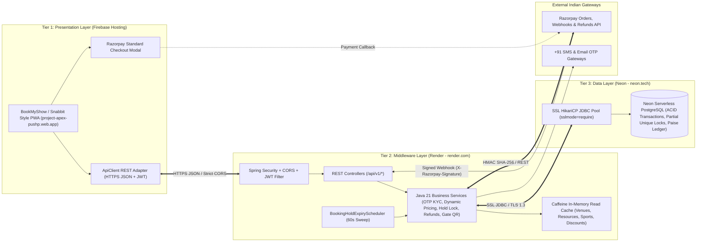
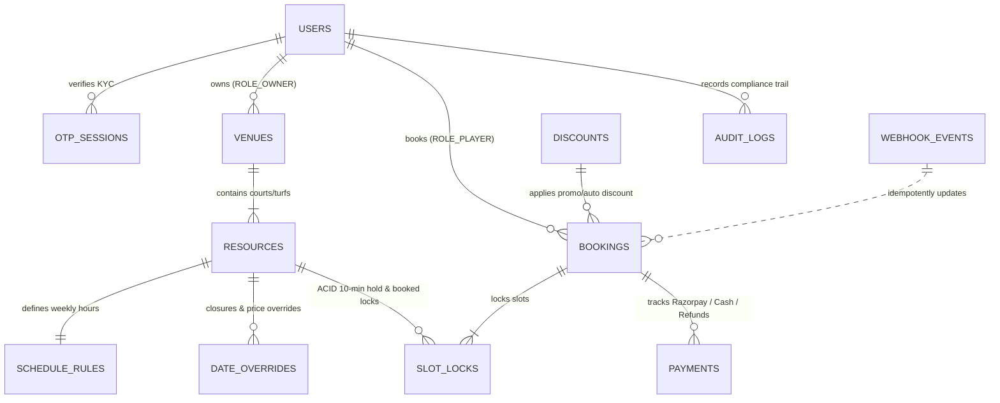

# Project Apex — Authoritative Business Requirements Document (BRD)
**Document ID:** `APEX-BRD-3.0`  
**Document Version:** `3.0.0` (Upgraded 3-Tier Multi-Cloud Architecture)  
**Governing Agent:** `apex-ba` (Business Analyst)  
**Coordinating Agents:** `apex-pm` (Project Manager), `apex-backend`, `apex-database`, `apex-frontend`, `apex-deployment`  
**Target Geographies:** Mumbai, Thane, and Navi Mumbai (Mumbai Metropolitan Region — MMR)  
**Target Cloud Stack:** Firebase Hosting (`project-apex-pushp.web.app`) ⇄ Render Java 21 Spring Boot (`render.com`) ⇄ Neon Serverless PostgreSQL (`neon.tech`)  
**Status:** Authoritative Baseline — Aligned with `docs/prd.md` & `docs/technical-spec-java-backend-architecture.md`  

---

## 1. Executive Summary & Architectural Evolution

**Project Apex** is a unified, multi-tenant sports facility discovery, dynamic pricing, slot reservation, and venue management platform engineered for the high-density Mumbai Metropolitan Region (MMR) — spanning **Mumbai** (South/Central Mumbai & Western/Eastern Suburbs), **Thane**, and **Navi Mumbai**. It connects players, tournament organizers, and corporate sports leads with commercial sports arenas offering Box Cricket turfs, 5-a-side Football turfs, Badminton courts, Pickleball/Padel courts, Squash courts, Lawn Tennis courts, and Cue Sports.

### 1.1 Architectural Evolution (v1.0 → v2.0 → v3.0 Multi-Cloud)
To scale safely from MVP validation to production-grade financial integrity and concurrent demand spikes across Mumbai and Thane, Project Apex upgrades into a **3-Tier Multi-Cloud Architecture**:

| Architecture Generation | Tier 1 (Presentation) | Tier 2 (Application Middleware) | Tier 3 (Persistence & Transactions) | Concurrency & Payment Authority |
| :--- | :--- | :--- | :--- | :--- |
| **v1.0 (`docs/prd.md`)** | Static PWA on Firebase Hosting | None (Zero Cloud Functions; client-side JS engines) | Client-direct Cloud Firestore (Spark Free Tier) | 5-min client-side Firestore lock; simulated checkout |
| **v2.0 (`docs/technical-spec-java-backend-architecture.md`)** | Responsive Web/PWA on Firebase Hosting | Java 21 + Spring Boot 3.2.3 REST Middleware | Hosted Cloud Firestore via Firebase Admin SDK & Caffeine cache | Server-side hold locks (`HOLD_TTL_MS`), Razorpay Orders & HMAC SHA-256 |
| **v3.0 (Authoritative BRD Target)** | **Firebase Hosting** (`project-apex-pushp.web.app`) | **Render (`render.com`)** containerized Java 21 LTS + Spring Boot 3.2.x REST API | **Neon (`neon.tech`)** Serverless PostgreSQL via TLS/SSL JDBC Pool | **10-min ACID DB hold locks** in PostgreSQL; authoritative paise ledger & idempotent Razorpay webhooks |

### 1.2 Upgraded 3-Tier Multi-Cloud Blueprint

---

## 2. Indian Sports-Tech Market Research Analysis

### 2.1 Macro Dynamics in Mumbai, Thane & Navi Mumbai (MMR)
Severe urban land scarcity across Greater Mumbai, Thane, and Navi Mumbai limits public recreational grounds, driving rapid commercialization of rooftop, industrial-shed, and standalone multi-sport arenas. Operators face two structural revenue leaks:
1. **Weekend & Prime-Evening Bottlenecks:** Friday–Sunday and weekday 7:00 PM–11:00 PM prime slots overbook via uncoordinated WhatsApp threads and manual paper registers, triggering double-booking disputes.
2. **Severe Daytime Underutilization:** Between 11:00 AM and 4:00 PM on weekdays, outdoor and indoor facilities experience **35%–45% idle inventory**, depressing return on high urban lease costs.
3. **Explosive Racquet & Convertible Turf Growth:** Beyond Box Cricket (6v6/8v8) and 5-a-side Football, MMR has witnessed rapid expansion in **indoor Badminton (BWF synthetic/wooden courts)** and **Pickleball / Padel** due to smaller spatial footprints and higher revenue yield per square foot, alongside convertible multi-sport turfs.

### 2.2 Competitive Benchmarking (India & MMR)

| Competitor | Market Positioning & Scale | Core Feature Strengths | Monetization & Commercial Model | Identified Gaps & Project Apex Differentiation |
| :--- | :--- | :--- | :--- | :--- |
| **Playo** | Community-first national scale leader; deep inventory across Mumbai suburbs, Navi Mumbai, and Thane (Kasarvadavali, Brahmand, Thane West) | "Play Pal" matchmaking, public Open Play pickup games, trainers/coaching discovery, tournaments, split payments | Marketplace booking commission (~5%–7% + GST on marketplace-routed bookings) + player convenience fee | High commission drag on venue owners' repeat neighborhood regulars; Apex introduces a zero/low-commission B2B SaaS ledger option alongside automated odd-hour yield rules. |
| **Hudle** | Urban sports & corporate hub specialist across Mumbai MMR, Thane, Dombivli, and Bhiwandi outskirts | Corporate tournaments, "Hudle Squad" multi-day passes, built-in bill splitting, GRIP racquet ratings, Hudle Vision AI stats, bundled partner SaaS tools | Hybrid marketplace commission + custom corporate/enterprise tournament agreements + partner portal | Complex enterprise onboarding; Apex delivers instant self-serve owner onboarding with immediate dynamic slot generation and walk-in cash turnstile reconciliation. |
| **Turf Town** | Clean consumer-first urban turf booking platform across Mumbai, Bangalore, and Chennai | Minimalist mobile UI, ultra-fast football & box cricket slot checkout, "Host a Match" peer invite/vote links | Transactional marketplace commission + player checkout fees | Narrower sport taxonomy (primarily football/cricket) and limited B2B off-peak yield automation; Apex covers 8+ sports including Badminton, Pickleball, Squash, and Tennis with rule-driven off-peak pricing. |
| **KheloMore / Cricbuddy** | Grassroots Mumbai/Thane sports academy, gymkhana, box cricket, and coaching aggregator | Deep ties with traditional Mumbai clubs & gymkhanas, structured cricket/football coaching academies, aggressive cashback promos | Academy enrollment commissions, tournament fees, marketplace cut | Skewed toward coaching batches and seasonal leagues rather than real-time automated slot hold concurrency and multi-tier refund automation. |
| **B2B SaaS Challengers (e.g., Clutchr, Playzo)** | Emerging white-label venue software providers targeting turf operators | 0% commission direct booking links, basic calendar & GST invoicing (₹999–₹4,000/mo) | Flat monthly SaaS subscription | Lack consumer marketplace demand generation for filling idle weekday afternoon/night-owl slots. |
| **Project Apex (Target Position)** | **MMR-first Hybrid Marketplace + B2B Yield & Gate OS** | **ACID 10-min checkout locks, automated 20%–35% odd-hour + 15% bulk discounts, `ARENA-XXXXX` / `APEX-PASS-*` Gate QR verification, cash walk-in ledger, Dual OTP KYC** | **Dual Track: Marketplace discovery commission OR B2B SaaS slot ledger (₹1,000–₹4,000/mo)** | **Eliminates double-booking via Neon PostgreSQL ACID locks, lifts off-peak occupancy via dynamic rules, and protects owner margins on repeat regulars.** |

### 2.3 MMR Pricing Benchmarks & Temporal Elasticity

| Micro-Market Tier | Representative MMR Localities | Benchmark Hourly Rate (INR) | Benchmark Stored Rate (Paise) | Primary Sport Mix |
| :--- | :--- | :--- | :--- | :--- |
| **Tier A: Budget Outskirts** | Thane Outskirts (Kasarvadavali edge), Dombivli, Kalyan, Mira Road, Bhiwandi | **₹500 – ₹1,000 / hr** | `50,000 – 100,000` paise | Box Cricket, Open-air Pickleball, Local Badminton |
| **Tier B: Mid-Range Urban Hubs** | Thane West (Ghodbunder Rd, Majiwada, Vartak Nagar), Vashi, Kharghar, Borivali, Goregaon | **₹1,000 – ₹1,800 / hr** | `100,000 – 180,000` paise | 8v8 Box Cricket, 5v5 Football, Synthetic/Wooden Badminton, Pickleball |
| **Tier C: Prime Mumbai** | Bandra West, BKC, Andheri West, Juhu, Powai, Lower Parel, Worli | **₹1,800 – ₹3,000+ / hr** | `180,000 – 300,000+` paise | FIFA-grade Football Turfs, Convertible Cricket, Glass Squash, Clay Tennis, Padel/Pickleball |

**Demand Elasticity Multipliers:**
- **Weekend Peak Surge (Sat/Sun & Prime Weekday Evenings 18:00–23:00):** **+15% to +30%** above base weekday rate (e.g., `weekendPricePaise = 1.30x` or `peakHourPricePaise = 1.20x–1.30x`).
- **Weekday Off-Peak / Odd-Hour Stimulation:** **-20% to -35% discounts** across Early Bird (`06:00–08:00`), Afternoon Grind (`11:00–16:00`), and Night Owl (`23:00–02:00` / `22:00–02:00` configurable) bands to capture college groups, remote workers, fitness clubs, and late-shift teams.

### 2.4 Dual Monetization Strategy & Commercial Settlement
To overcome venue owner resistance to high marketplace fees on loyal repeat players, Project Apex supports a **Dual Monetization Model**:

1. **Track A — Marketplace Commission Model (Discovery & Growth Venues):**
   - Applies to consumer bookings discovered and paid through Project Apex marketplace (`project-apex-pushp.web.app`).
   - **Commercial Structure:** Platform marketplace commission (**5%–8% + applicable GST**, configurable per partner tier) plus nominal player platform convenience fee (benchmark **₹20 / `2000 paise`** where enabled).
   - **Best Fit:** Newly launched turfs and arenas in Ghodbunder Road, Vashi, or Andheri seeking incremental player discovery and off-peak demand stimulation.
2. **Track B — B2B SaaS Slot Ledger Model (Zero/Low-Commission Regulars):**
   - **Subscription Benchmark:** **₹1,000 – ₹4,000 / month** per venue (tiered by active court/turf count: e.g., ₹1,000/mo single-court starter; ₹2,500/mo multi-court hub; ₹4,000/mo multi-sport flagship with analytics & dynamic discount automation).
   - **Commission Treatment:** **0% marketplace commission** on direct owner walk-in counter bookings (`POST /api/v1/gate/walk-in`) and repeat-regular direct links (only actual Razorpay payment gateway TDR applies for online settlements).
   - **Best Fit:** Established arenas with 60%+ repeat neighborhood clientele who need unified Neon-backed double-booking protection, QR gate verification, and cash + UPI ledger consolidation.
3. **Settlement Cadence (`docs/legal/vendor-partner-agreement.md`):**
   - Net online booking earnings settled on a **T+1 (24-hour)** cycle via IMPS/NEFT to the Venue Partner's KYC-verified bank account, retaining forfeited player cancellation shares (50% on Tier 2, 100% on Tier 3).

---

## 3. Target Geographies & Sports Taxonomy

### 3.1 Geographic Clusters
1. **Thane Zone:** Ghodbunder Road, Majiwada, Vartak Nagar, Hiranandani Estate, Teen Hath Naka, Kasarvadavali, Dombivli/Outskirts.
2. **Mumbai Suburbs:** Bandra West, Andheri West/East, Powai, Juhu, Goregaon, Borivali, Malad, Ghatkopar.
3. **South & Central Mumbai:** BKC, Lower Parel, Worli, Dadar, Colaba.
4. **Navi Mumbai:** Vashi, Nerul, Kharghar, Seawoods, Belapur, Airoli.

### 3.2 Supported Sports Taxonomy (`SportType`)
- `CRICKET_TURF`: Box Cricket (6v6 / 8v8 artificial turf, boundary netting, floodlights).
- `FOOTBALL_TURF`: 5-a-side / 7-a-side FIFA-grade synthetic grass, goals, floodlights.
- `MULTI_SPORT`: Convertible Cricket/Football modular arenas.
- `BADMINTON`: BWF-certified synthetic or teakwood indoor courts.
- `PICKLEBALL` (and **Padel** extensibility): High-yield hard/synthetic courts with net & paddle rentals.
- `SQUASH`: Glass-backed air-conditioned indoor courts.
- `LAWN_TENNIS`: Clay and hard courts with tournament lighting.
- `POOL_TABLE`: Indoor English snooker and pool lounges.

---

## 4. User Personas & Core Workflows

| Persona | Archetype & Context | Primary Goals | Key Pain Points Solved by Apex | Assigned RBAC Role |
| :--- | :--- | :--- | :--- | :--- |
| **1. Casual Player** | *Rohan Deshmukh* (27, Tech/Ops Professional, Thane West) | Discover nearby Box Cricket/Badminton slots, lock 1–2 slots in <60s, apply off-peak or `THANE50`/`TURF20` promos, get scannable QR pass. | WhatsApp booking delays, hidden surcharges, slot stolen mid-payment, unfair no-refund policies. | `ROLE_PLAYER` (`player`) |
| **2. Tournament Organizer** | *Vikram Joshi* (24, Inter-College & Local Box Cricket League Lead, Mulund/Thane) | Reserve 2–6 consecutive hours across multiple turfs, auto-trigger 15% bulk discount, verify gate entry smoothly for squads. | Multi-slot pricing miscalculations, manual bank transfers, last-minute venue rainout losses. | `ROLE_PLAYER` (Extended bulk booking flows) |
| **3. Corporate Booking Lead** | *Meera Nair* (33, HR/Admin Coordinator, Wagle Estate / Powai / BKC) | Book Friday evening or weekend corporate knockout events, access itemized quotes, receive verifiable payment receipts & T+1 refund assurance. | Lack of GST-compliant receipts, opaque peak surges, zero accountability if venue cancels. | `ROLE_PLAYER` (Corporate promo & bulk flows) |
| **4. Venue Owner / Partner** | *Santosh Kadam* (45, Proprietor of *Apex Arena Ghodbunder*, Thane) | Configure arenas (capacity, surface, floodlights, paise rates), boost idle 11 AM–4 PM occupancy, record walk-in cash bookings, scan QR passes at turnstile. | Double-bookings between walk-ins and online apps, 40% empty weekday afternoons, high commissions on repeat regulars. | `ROLE_OWNER` (`venue_owner`) |
| **5. Platform Admin** | *Project Apex Ops Admin* | Approve/verify new partner KYC (GST/PAN), moderate active/inactive venues, audit Razorpay webhooks, refunds, and Render/Neon health. | Fraudulent turf listings, webhook race disputes, cross-tenant data leaks. | `ROLE_ADMIN` (`admin`) |

---

## 5. Strictly Codified Business Rules (BA-01 through BA-08)

### BA-01: Dual OTP KYC & Role Isolation
1. **Mandatory Dual Verification on Registration:**
   - Every new user (Player or Facility Owner) registering via KYC OTP flow MUST supply a valid **10-digit Indian Mobile Number (`+91`)** matching `^(?:\+91|91)?[6-9]\d{9}$` (normalized to `+91 XXXXX XXXXX`) AND a valid **RFC 5322 Email Address**.
   - The Tier 2 middleware (`OtpService`) generates two independent cryptographic 6-digit numeric OTP codes: one dispatched to Mobile SMS and one to Email.
   - **OTP Lease & Brute-Force Guard:** Both OTPs share a strict **5-minute (300-second) TTL** (`app.otp.ttl-seconds=300`) and allow a **maximum of 3 failed verification attempts** before the OTP session is locked and requires re-issuance.
   - Upon dual OTP verification, both `is_phone_verified` and `is_email_verified` are persisted as `true`, newly onboarded Players receive **100 welcome loyalty points**, and an immutable `USER_CREATED` / `OTP_VERIFIED_SUCCESS` audit record is written.
2. **Hashed Password Support & Authentication Modes:**
   - Users may additionally set a password stored strictly as a cryptographic hash (`password_hash`, never plaintext) supporting both OTP login (`/api/v1/auth/login/send-otp` + `/verify-otp`) and credential login (`/api/v1/auth/login/password`, `/api/v1/auth/register`).
3. **Role Isolation & Zero Data Leakage:**
   - Stateless JWT tokens encode `uid`, `role` (`ROLE_PLAYER`, `ROLE_OWNER`, `ROLE_ADMIN`), `fullName`, `phone`, and `email` with 24-hour expiration (`jwt.expiration-ms=86400000`).
   - Spring Security enforces route-level RBAC: `/api/v1/owner/**` requires `ROLE_OWNER` or `ROLE_ADMIN`; `/api/v1/admin/**` requires `ROLE_ADMIN`.
   - **Zero Booking Data Leakage:** `GET /api/v1/bookings/my` and `GET /api/v1/bookings/{bookingId}` MUST extract the principal `uid` strictly from the verified JWT `Authentication` context, rejecting cross-user reads or cancellations with `403 Forbidden` / `IllegalStateException`. Production deployments MUST disable any fallback `"demo_player"` / `"demo_owner"` anonymous defaults.

**Acceptance Criteria (BA-01):**
- **AC-01.1:** *Given* a new user submits `+91 98201 12345` and `rohan@apex.dev`, *When* `POST /api/v1/auth/registration/send-otp` is called, *Then* two distinct 6-digit OTPs are issued with a 300s expiry and `attemptsRemaining = 3`.
- **AC-01.2:** *Given* 3 consecutive wrong OTP submissions on a registration session, *When* a 4th attempt is made within 5 minutes, *Then* the API rejects verification and enforces requesting fresh OTPs.
- **AC-01.3:** *Given* Player A holds a valid JWT for `usr_A`, *When* Player A calls `GET /api/v1/bookings/my` or requests Player B's `bookingId`, *Then* only bookings owned by `usr_A` are returned and cross-user access returns HTTP 403/error.

---

### BA-02: Owner Onboarding & Facility Management
1. **Partner KYC Onboarding:**
   - Facility Owner registration (`POST /api/v1/auth/register-owner` or verified dual-OTP owner signup) captures `ownerName`, `businessName`, `businessAddress`, `city`, optional/KYC `gstNumber` (15-char GSTIN) and `panNumber` (10-char PAN), setting `verificationStatus` (`APPROVED` when `app.owner.auto-approve=true`, or `PENDING_APPROVAL` for manual `ROLE_ADMIN` review via `PATCH /api/v1/admin/owners/{uid}/verify`).
   - Auto-provisions an initial `Venue` and primary `Resource` (or lets the owner manage multiple venues and courts/turfs via `/api/v1/owner/venues`, `/api/v1/owner/venues/{venueId}/resources`, and `/api/v1/facilities`).
2. **Granular Facility & Resource Specifications:**
   - Each playable resource/court records: `name`, `sportTypes` (`CRICKET_TURF`, `FOOTBALL_TURF`, `BADMINTON`, `PICKLEBALL`, `SQUASH`, `LAWN_TENNIS`, `POOL_TABLE`, `MULTI_SPORT`), `maxPlayers` / `capacity` (e.g., 16 for 8v8 cricket, 10 for 5v5 football, 4 for doubles racquet), `dimensions` (e.g., `115ft x 65ft`), `surfaceType` (e.g., `ARTIFICIAL_TURF`, `15mm Monofilament Synthetic Turf`, `SYNTHETIC`, `WOODEN`, `CLAY`, `HARD_COURT`), `hasFloodlights`, `isIndoor`, `amenities`, and `slotDurationMinutes` (`30`, `60`, or `90`).
3. **Integer Paise Rate Precision:**
   - All monetary fields (`basePricePaise`, `weekendPricePaise`, `peakHourPricePaise`, `minSlotPricePaise`) MUST be validated (`baseHourlyRate >= ₹200` / `20000 paise` minimum for facilities) and persisted strictly as **64-bit integer paise** (`BIGINT` in Neon PostgreSQL; **1 INR = 100 paise**).
   - Default surge multipliers when omitted: `peakHourPricePaise = 1.25x–1.30x basePricePaise`; `weekendPricePaise = 1.30x basePricePaise`.
4. **Immediate Availability Generation:**
   - Creating a venue resource immediately persists a default `ScheduleRule` (`06:00`–`23:00` across Mon–Sun, peak windows `18:00`–`22:00`) so real-time slot queries return bookable inventory immediately without pre-generating empty slot rows in Neon PostgreSQL. Owners can customize weekly schedules (`PUT /api/v1/owner/resources/{resourceId}/schedule`) and date-specific closures/price overrides (`PUT /api/v1/owner/resources/{resourceId}/overrides/{date}`).

**Acceptance Criteria (BA-02):**
- **AC-02.1:** *Given* an authenticated `ROLE_OWNER` submits a new resource with capacity `16`, dimensions `115ft x 65ft`, surface `ARTIFICIAL_TURF`, `hasFloodlights: true`, and base rate `120000` paise (₹1,200), *When* `POST /api/v1/owner/venues/{venueId}/resources` succeeds, *Then* the resource and default weekly `ScheduleRule` are persisted in Neon PostgreSQL in integer paise and `GET /api/v1/slots` immediately returns available slots for today and future dates.
- **AC-02.2:** *Given* Owner A owns `venue_01` and Owner B owns `venue_02`, *When* Owner B calls `PUT /api/v1/owner/venues/venue_01`, *Then* the middleware denies modification with an unauthorized error.

---

### BA-03: Dynamic Slot Generation & Pricing Matrix
1. **Real-Time Slot Generation:**
   - `GET /api/v1/slots` and `GET /api/v1/availability` compute discrete slots dynamically from `Resource` + `ScheduleRule` + `DateOverride` + active `SlotLocks`. Past slots on the current IST date are marked `PAST`; full-day or slot-level maintenance blocks are marked `BLOCKED`.
2. **Base/Peak/Override Price Resolution Hierarchy:**
   - Per slot, authoritative base price resolves in strict priority:
     1. `DateOverride.slotPriceOverrides[startTime]` (custom event/holiday rate)
     2. `Resource.peakHourPricePaise` (if `startTime` falls inside configured peak window, e.g., `18:00–22:00`)
     3. `Resource.weekendPricePaise` (if booking date is `SATURDAY` or `SUNDAY`, reflecting +15% to +30% surge)
     4. `Resource.basePricePaise`
3. **Time-Band Off-Peak Auto-Discounts:**
   - **Early Bird (`06:00 – 08:00` / up to `09:00` configurable, Mon–Fri):** **20% OFF** (`OFF_PEAK_AUTO`)
   - **Afternoon Grind (`11:00 – 16:00`, Mon–Fri):** **35% OFF** (`OFF_PEAK_AUTO`; seeded default rule may be configured at 25%–35% per venue/resource)
   - **Night Owl (`23:00 – 02:00` / `22:00 – 02:00`, Daily):** **25% OFF** (`OFF_PEAK_AUTO`)
4. **Bulk Multi-Slot Auto-Discount:**
   - Booking **2 or more slots (`slotStartTimes.size() >= 2`)** in a single checkout automatically qualifies for **15% OFF** (`BULK_SLOTS_AUTO`, `disc_bulk`).
   - When multiple non-stackable automatic discounts apply (`OFF_PEAK_AUTO` vs `BULK_SLOTS_AUTO`), the pricing engine selects the **highest savings (`bestAutoDiscountPaise`)** in the player's favor.
5. **Promotional Coupon Codes & Stacking:**
   - `TURF20`: **20% OFF** (`PERCENTAGE`, max discount **₹500 / `50000 paise`**, minimum order **₹1,000 / `100000 paise`**).
   - `THANE50`: **Flat ₹50 OFF** (`FLAT_PAISE`, **`5000 paise`**, minimum order **₹500 / `50000 paise`**; Thane welcome promo).
   - Additional platform campaign codes (`APEX20`: 20% off up to ₹200; `ODDHOUR35`: stackable extra odd-hour bonus) managed via `POST /api/v1/owner/discounts` and `PATCH /api/v1/owner/discounts/{id}/toggle`.
   - **Stacking Logic:** If `promoDiscount.isStackableWithAutoDiscount == true`, `totalDiscountPaise = promoDiscountPaise + bestAutoDiscountPaise`; otherwise `totalDiscountPaise = max(promoDiscountPaise, bestAutoDiscountPaise)`.
6. **Razorpay Minimum Order Guard:**
   - Every authoritative server-side quote (`POST /api/v1/pricing/quote` and `POST /api/v1/bookings/initiate`) MUST clamp payable total:
     `finalPayablePaise = Math.max(100L, subtotalPaise - totalDiscountPaise + taxPaise)`
     ensuring no Razorpay order is ever requested below **100 paise (₹1.00)**.

**Acceptance Criteria (BA-03):**
- **AC-03.1:** *Given* a weekday turf slot priced at `120000` paise (₹1,200) at `13:00` (Afternoon Grind 35% off), *When* `POST /api/v1/pricing/quote` is evaluated, *Then* the quote applies `42000` paise discount (35% off) yielding `78000` paise (₹780).
- **AC-03.2:** *Given* a player selects 2 evening slots (`19:00`, `20:00`) at ₹1,500/slot (`300000` paise) with promo `TURF20`, *When* `PricingAndDiscountService` evaluates non-stackable `BULK_SLOTS_AUTO` (15% = `45000` paise) vs `TURF20` (20% capped at `50000` paise), *Then* `TURF20` (`50000` paise) is selected and `finalPayablePaise = 250000`.
- **AC-03.3:** *Given* a discount exceeds subtotal on a low-value slot, *When* quote is finalized, *Then* `finalPayablePaise >= 100` (₹1.00 minimum Razorpay constraint).

---

### BA-04: Atomic Concurrency Hold
1. **10-Minute Checkout Hold Lease:**
   - When a player initiates checkout (`POST /api/v1/bookings/initiate`), Tier 2 MUST atomically acquire a **10-minute hold lock** (`BOOKING_HOLD_MINUTES = 10`, `HOLD_TTL_MS = 600,000 ms`) across **all** requested `(resource_id, booking_date, start_time)` slots before creating the Razorpay order.
   - Note: This 10-minute server-enforced hold supersedes the v1.0 5-minute client-side Firestore hold to accommodate Indian UPI app switching (GPay/PhonePe/Paytm) and 2FA OTP delays.
2. **Neon PostgreSQL ACID Concurrency Enforcement:**
   - Concurrency isolation MUST NOT rely solely on JVM `synchronized` locks (which fail across horizontally scaled Render instances).
   - Neon Serverless PostgreSQL MUST enforce exclusivity at the database layer via a **unique constraint / partial unique index** on `slot_locks(resource_id, booking_date, start_time)` inside an ACID transaction (`@Transactional(isolation = Isolation.READ_COMMITTED)` with `INSERT ... ON CONFLICT` / row-level `SELECT ... FOR UPDATE`).
   - Lock conflict rules:
     - Existing lock `status = 'BOOKED'` → Reject with HTTP `409 Conflict`.
     - Existing lock `status = 'HELD'` AND `hold_expires_at > NOW()` AND `user_id != requester_uid` → Reject with HTTP `409 Conflict` (`"Slot is currently held by another user"`).
     - Existing lock `status = 'HELD'` AND `hold_expires_at <= NOW()` → Expired lease is atomically reclaimed for the new requester.
     - Same-user retry while hold is still valid → Idempotent / safe re-entry allowed without self-blocking.
3. **Hold Expiry Sweeper:**
   - `BookingHoldExpiryScheduler` executes every **60 seconds** (`@Scheduled(fixedDelay = 60000)`), updating `PENDING_PAYMENT` bookings where `hold_expires_at < NOW()` to `EXPIRED` and releasing their `HELD` rows in `slot_locks`.

**Acceptance Criteria (BA-04):**
- **AC-04.1:** *Given* Player A and Player B concurrently send `POST /api/v1/bookings/initiate` for `res_thane_crk_01`, `2026-12-01`, `["19:00", "20:00"]` within 20ms, *When* Neon PostgreSQL executes both transactions, *Then* exactly one player acquires the 10-minute `HELD` lock and receives `bookingId` + `razorpayOrderId`, while the other player fails atomically with `409 Conflict` and zero partial locks remain.
- **AC-04.2:** *Given* Player A abandons payment and 10 minutes + 60 seconds elapse, *When* `BookingHoldExpiryScheduler` runs (or Player C attempts booking), *Then* Booking A transitions to `EXPIRED` and the slot returns to `AVAILABLE`.

---

### BA-05: Razorpay Payment & Webhook Idempotency
1. **Integer Paise Order Creation:**
   - `RazorpayService.createOrderInPaise` creates a Razorpay Order with `amount = finalPayablePaise` (integer paise, `>= 100`), `currency = "INR"`, `receipt = bookingId`, and metadata `notes = { bookingId, venueId, resourceId, userId }`.
2. **Cryptographic HMAC SHA-256 Verification:**
   - **Synchronous Callback (`POST /api/v1/bookings/{bookingId}/verify-payment`):** Middleware recomputes `HmacSHA256(razorpay_order_id + "|" + razorpay_payment_id, razorpay.key-secret)` and verifies constant-time equality against `razorpay_signature`. Invalid signatures immediately reject confirmation.
   - **Asynchronous Webhook (`POST /api/v1/webhooks/razorpay`):** Middleware verifies `X-Razorpay-Signature` against the **exact raw request body string/bytes** using `razorpay.webhook-secret` prior to JSON parsing.
3. **Webhook Idempotency & Race Safety:**
   - Every webhook carries `X-Razorpay-Event-Id` (or event idempotency key) persisted with a primary key/unique constraint in Neon `webhook_events`. Duplicate webhook deliveries for an already-processed `event_id` return HTTP `200 OK` without mutating bookings or payment ledgers.
   - If both synchronous `verify-payment` and asynchronous `order.paid` / `payment.captured` webhook arrive concurrently, the second execution sees `status = 'CONFIRMED'` and returns idempotently.
   - On `payment.failed` webhook, booking transitions to `PAYMENT_FAILED` and `HELD` `slot_locks` are deleted immediately.
4. **Conflict Auto-Refund (Late Payment After Hold Expiry):**
   - If `order.paid` or `payment.captured` arrives *after* `hold_expires_at < NOW()` AND another player has already `BOOKED` any slot in that booking, the system MUST preserve the existing confirmed booking, mark the late booking `CONFLICT_REFUND_PENDING`, automatically invoke `razorpayClient.payments.refund(paymentId, finalPayablePaise, "Late payment after hold expiry conflict")`, record `refundStatus = INITIATED`, and write a refund ledger entry.

**Acceptance Criteria (BA-05):**
- **AC-05.1:** *Given* a valid `razorpay_order_id`, `razorpay_payment_id`, and matching HMAC SHA-256 signature, *When* `POST /api/v1/bookings/{bookingId}/verify-payment` is called, *Then* the booking transitions to `CONFIRMED`, slot locks transition `HELD` → `BOOKED`, a `payments` ledger row is committed in paise, and a unique `ARENA-XXXXX` code is issued.
- **AC-05.2:** *Given* Razorpay replays the identical `payment.captured` webhook (`eventId = evt_123`) twice, *When* `POST /api/v1/webhooks/razorpay` executes, *Then* the first updates state/acknowledges and the second deduplicates on `webhook_events` and returns `200 OK` with zero duplicate payment rows.
- **AC-05.3:** *Given* Player A's hold expired and Player B booked the slot before Player A's delayed UPI capture webhook arrives, *When* `WebhookService` processes `payment.captured`, *Then* Player B's booking remains intact, Player A's booking enters `CONFLICT_REFUND_PENDING`, and a 100% auto-refund is initiated via Razorpay.

---

### BA-06: 3-Tier Cancellation & Refund Matrix
Player-initiated cancellations (`POST /api/v1/bookings/{bookingId}/cancel`) and Owner emergency cancellations (`POST /api/v1/owner/bookings/{bookingId}/cancel`) execute atomically against IST (`Asia/Kolkata`) match start time (`firstSlot.startTime` on `bookingDate`):

| Cancellation Tier | Trigger Window (`hoursUntilSlot`) | Player Refund Calculation (Paise) | Handling Fee / Deduction | Venue Compensation | Resulting Status & Lock State |
| :--- | :--- | :--- | :--- | :--- | :--- |
| **Tier 1 (Early Cancel)** | **`> 24 hours`** prior to first slot start | `max(0, finalPayablePaise - 5000)` (**100% minus ₹50 fee**) | **₹50 (`5000 paise`)** payment gateway/handling fee | 0% slot share | `CANCELLED_BY_USER`; `slot_locks` released |
| **Tier 2 (Moderate Notice)** | **`6 hours to 24 hours`** (`>= 6 && <= 24`) prior to slot start | `round(finalPayablePaise * 0.50)` (**50% refund**) | None additional | 50% forfeited fee | `CANCELLED_BY_USER`; `slot_locks` released |
| **Tier 3 (Last-Minute)** | **`< 6 hours`** prior to slot start | `0` paise (**0% refund**) | 100% forfeited | 100% forfeited fee | `CANCELLED_BY_USER`; `slot_locks` released |
| **Owner Emergency / Rainout** | Any time prior to match (`POST /api/v1/owner/bookings/{id}/cancel`) | `finalPayablePaise` (**100% full refund**) | **₹0** (fee waived) | 0% | `CANCELLED_BY_OWNER`; `slot_locks` released |

> [!IMPORTANT]
> **Alignment Note for Engineering:** `docs/prd.md`, `src/services/cancellationService.js`, `docs/legal/terms-of-service.md`, and **BA-06** mandate deducting the **₹50 (`5000 paise`)** processing fee on Tier 1 (`> 24h`) player cancellations (and fixing the `12-24h` typo in `docs/technical-spec-java-backend-architecture.md` §2 Workflow 9 back to `6-24h`). `BookingService.cancelBookingByPlayer` must enforce `Math.max(0L, booking.getFinalPayablePaise() - 5000L)` for Tier 1 when migrating to Neon PostgreSQL.

**Acceptance Criteria (BA-06):**
- **AC-06.1:** *Given* a confirmed booking for `₹1,200` (`120000` paise) starting 30 hours from now, *When* the owning player cancels, *Then* `refundAmountPaise = 115000` (₹1,150 = ₹1,200 minus ₹50 fee), Razorpay refund is initiated, and all slot locks are released back to `AVAILABLE`.
- **AC-06.2:** *Given* a confirmed booking starting 10 hours from now, *When* the player cancels, *Then* `refundAmountPaise = 60000` (50%), status becomes `CANCELLED_BY_USER`, and slots become `AVAILABLE`.
- **AC-06.3:** *Given* a confirmed booking starting 3 hours from now, *When* the player cancels, *Then* `refundAmountPaise = 0` (0%), no Razorpay refund API call is triggered, and slots are released.
- **AC-06.4:** *Given* a confirmed booking at a flooded turf 1 hour before match time, *When* the Facility Owner cancels via `/api/v1/owner/bookings/{id}/cancel`, *Then* `refundAmountPaise = 120000` (100% full refund, ₹0 fee deducted) and status becomes `CANCELLED_BY_OWNER`.

---

### BA-07: Gate QR Check-In & Walk-In Cash Settlement
1. **Cryptographic / Unique Pass Issuance:**
   - Every confirmed online booking generates a unique `bookingCode` formatted **`ARENA-XXXXX`** (5 uppercase alphanumeric characters, e.g., `ARENA-94K2M`) and a scannable `qrPassToken` formatted **`APEX-PASS-{bookingCode}`** (e.g., `APEX-PASS-ARENA-94K2M` or `APEX-PASS-{bookingId}`).
2. **Gate Turnstile Verification (`POST /api/v1/gate/verify-pass`):**
   - Restricted to `ROLE_OWNER` (for their own venues) and `ROLE_ADMIN`.
   - Accepts `qrPassToken` matching `APEX-PASS-*`, `ARENA-XXXXX`, or `bookingId`.
   - **Validation Matrix:**
     - **Unknown / Non-existent Token:** Returns `valid: false`, `"Invalid pass token"`.
     - **Cancelled / Expired / Failed Booking (`CANCELLED*`, `EXPIRED`, `PAYMENT_FAILED`):** Strictly **denied entry** (`IllegalStateException` / HTTP 409 `"Cancelled booking QR pass rejected at gate"`).
     - **Duplicate Scan (`CHECKED_IN` or `COMPLETED`):** Strictly **blocked** (`valid: false, alreadyCheckedIn: true, "Already checked in"`) to prevent QR screenshot reuse or tailgating.
     - **Valid `CONFIRMED` Pass:** Atomically transitions status `CONFIRMED` → `CHECKED_IN`, records `checked_in_at` timestamp, and logs a gate audit event.
3. **Counter Walk-In & Cash Settlement (`POST /api/v1/gate/walk-in`):**
   - Allows authenticated Venue Owners to reserve an open slot for offline/walk-in players (`courtId`/`resourceId`, `date`, `slot`, `customerName`, `customerPhone`, `amountCollected`).
   - Atomically checks and writes a `BOOKED` row in `slot_locks` in Neon PostgreSQL so online players cannot double-book the slot, issues code `ARENA-WALKIN-XXXX`, and records `CASH` settlement in integer paise (`amountCollected * 100`).

**Acceptance Criteria (BA-07):**
- **AC-07.1:** *Given* a `CONFIRMED` booking with `bookingCode = ARENA-94K2M` (`APEX-PASS-ARENA-94K2M`), *When* the Venue Owner scans the token at `/api/v1/gate/verify-pass`, *Then* access is granted (`valid: true`) and status transitions to `CHECKED_IN`.
- **AC-07.2:** *Given* the same token is scanned a second time 5 minutes later, *When* `/api/v1/gate/verify-pass` is called, *Then* entry is blocked with `alreadyCheckedIn: true` and `valid: false`.
- **AC-07.3:** *Given* a booking was cancelled (`CANCELLED_BY_USER` or `CANCELLED_BY_OWNER`), *When* its QR pass is scanned at the gate, *Then* gate entry is rejected.
- **AC-07.4:** *Given* a Venue Owner submits a walk-in cash booking for `17:00` at ₹1,000, *When* `POST /api/v1/gate/walk-in` succeeds, *Then* the slot immediately displays as `BOOKED` on the public Firebase UI and `100000` paise cash revenue is recorded in the owner ledger.

---

### BA-08: Cloud SLA & Tier Separation
1. **Strict 3-Tier Multi-Cloud Separation of Concerns:**
   - **Tier 1 — Firebase Hosting (`https://project-apex-pushp.web.app`):** Static Web/PWA presentation layer + Razorpay Checkout modal. Communicates with Tier 2 strictly over **HTTPS JSON REST** with explicit **CORS** allowlisting (`https://project-apex-pushp.web.app`, `https://project-apex-pushp.firebaseapp.com`, and local dev ports). Contains **zero** database connection strings, **zero** Razorpay secrets, and **zero** authoritative pricing or lock logic.
   - **Tier 2 — Render (`render.com`):** Containerized Java 21 LTS (`eclipse-temurin:21-jre-jammy`) + Spring Boot 3.2.x stateless REST middleware. Handles JWT auth, business validation, Caffeine read caching (`venues`, `resources`, `sports`, `discounts`), Razorpay SDK calls, and `@Scheduled` hold cleanup. All secrets (`DATABASE_URL`, `JWT_SECRET`, `RAZORPAY_KEY_SECRET`, `RAZORPAY_WEBHOOK_SECRET`) are injected strictly via Render environment variables.
   - **Tier 3 — Neon Serverless PostgreSQL (`neon.tech`):** Authoritative relational store accessed exclusively by Tier 2 over **TLS/SSL JDBC Connection Pool** (`sslmode=require`, HikariCP configured for pooled Neon endpoint `-pooler`, bounded `maximumPoolSize` matched to Render memory & Neon connection quotas, connection validation/keepalive for serverless wakeup resilience).
2. **Performance, Availability & Recovery SLAs:**
   - **Availability Target:** `99.9%` uptime during prime MMR operating hours (`06:00 – 02:00 IST`).
   - **API Latency Targets (warm tier):**
     - Health endpoint (`GET /api/v1/health`): `< 100ms` p95.
     - Cached venue discovery (`GET /api/v1/venues`): `< 200ms` p95.
     - Dynamic slot availability (`GET /api/v1/slots`): `< 300ms` p95.
     - Atomic booking hold (`POST /api/v1/bookings/initiate`): `< 500ms` p95 (including Neon ACID lock + Razorpay Order creation).
     - Gate QR scan (`POST /api/v1/gate/verify-pass`): `< 300ms` p95.
   - **Data Durability:** Zero data loss (`RPO = 0`) on committed bookings, slot locks, and paise financial transactions via Neon WAL durability and point-in-time recovery (PITR).

**Acceptance Criteria (BA-08):**
- **AC-08.1:** *Given* a browser request originates from `https://project-apex-pushp.web.app` to the Render middleware API, *When* preflight `OPTIONS` and `GET/POST` requests run, *Then* HTTPS JSON + CORS headers succeed, while unauthorized origins are rejected by production CORS policy.
- **AC-08.2:** *Given* the Tier 1 client bundle is inspected, *When* scanning static JS/HTML assets on Firebase Hosting, *Then* zero PostgreSQL credentials, zero `key_secret`/`webhook_secret`, and zero `jwt.secret` strings are present.
- **AC-08.3:** *Given* Tier 2 restarts or scales on Render, *When* connecting to Neon PostgreSQL via SSL JDBC pool, *Then* all active `slot_locks`, `bookings`, `payments`, and `webhook_events` persist with full ACID integrity and zero in-memory data loss.

---

## 6. Logical Relational Data Contract (Neon Serverless PostgreSQL)

To guide `apex-database` and `apex-backend` during migration from `FirebaseService` in-memory/Firestore maps to **Neon Serverless PostgreSQL**, all business state maps to the following normalized ACID tables (all monetary columns stored as `BIGINT` paise; all timestamps stored as UTC `TIMESTAMPTZ` / epoch millis with `Asia/Kolkata` evaluation for slot windows):

| Table Name | Primary Key & Unique Constraints | Key Domain Columns | BA Rule Enforced |
| :--- | :--- | :--- | :--- |
| `users` | `PK (uid)`, `UNIQUE (phone)`, `UNIQUE (email)` | `display_name`, `phone`, `email`, `password_hash`, `role` (`ROLE_PLAYER`/`ROLE_OWNER`/`ROLE_ADMIN`), `city`, `is_phone_verified`, `is_email_verified`, `loyalty_points`, `business_name`, `gst_number`, `pan_number`, `verification_status` | BA-01, BA-02 |
| `otp_sessions` | `PK (session_id)` | `phone`, `email`, `phone_otp`, `email_otp`, `login_otp`, `purpose`, `expires_at`, `attempts_remaining`, `is_verified` | BA-01 |
| `venues` | `PK (venue_id)`, `FK (owner_id -> users.uid)` | `name`, `locality`, `city`, `address_line`, `pincode`, `latitude`, `longitude`, `sport_types`, `min_slot_price_paise BIGINT`, `cancellation_policy JSONB`, `monetization_track` (`COMMISSION`/`SAAS_LEDGER`), `status` | BA-02, BA-06 |
| `resources` | `PK (resource_id)`, `FK (venue_id)` | `owner_id`, `name`, `sport_types`, `slot_duration_minutes`, `base_price_paise BIGINT`, `weekend_price_paise BIGINT`, `peak_hour_price_paise BIGINT`, `max_players`, `dimensions`, `surface_type`, `has_floodlights`, `is_indoor`, `is_active` | BA-02, BA-03 |
| `schedule_rules` | `PK (resource_id)` | `venue_id`, `owner_id`, `weekly_schedule JSONB` (Mon–Sun open/close + peak windows) | BA-02, BA-03 |
| `date_overrides` | `PK (resource_id, override_date)` | `is_closed_full_day`, `custom_open_time`, `custom_close_time`, `slot_price_overrides JSONB`, `blocked_slots JSONB` | BA-02, BA-03 |
| `discounts` | `PK (discount_id)`, `UNIQUE (code)` | `owner_id`, `name`, `type` (`OFF_PEAK_AUTO`/`BULK_SLOTS_AUTO`/`PROMO_CODE`), `code`, `value`, `value_type`, `max_discount_paise BIGINT`, `min_order_paise BIGINT`, `min_slots`, `time_window_start`, `time_window_end`, `days_of_week`, `stackable_with_auto`, `is_active` | BA-03 |
| `slot_locks` | `PK (lock_id)`, **`UNIQUE INDEX (resource_id, booking_date, start_time)`** | `venue_id`, `end_time`, `booking_id`, `user_id`, `status` (`HELD`/`BOOKED`), `hold_expires_at` | BA-04, BA-07 |
| `bookings` | `PK (booking_id)`, `UNIQUE (booking_code)` | `booking_code` (`ARENA-XXXXX`), `qr_pass_token` (`APEX-PASS-*`), `user_id`, `owner_id`, `venue_id`, `resource_id`, `booking_date`, `slots JSONB`, `subtotal_paise BIGINT`, `discount_amount_paise BIGINT`, `tax_paise BIGINT`, `final_payable_paise BIGINT`, `status`, `razorpay_order_id`, `razorpay_payment_id`, `refund_id`, `refund_amount_paise BIGINT`, `refund_status`, `hold_expires_at`, `checked_in_at` | BA-04, BA-05, BA-06, BA-07 |
| `payments` | `PK (payment_id)`, `FK (booking_id)` | `user_id`, `owner_id`, `payment_method` (`RAZORPAY`/`CASH`), `razorpay_order_id`, `razorpay_payment_id`, `amount_paise BIGINT`, `entry_type` (`CAPTURE`/`REFUND`), `status` | BA-05, BA-06, BA-07 |
| `webhook_events` | `PK (event_id)` | `event_type`, `processing_status`, `received_at` | BA-05 |
| `audit_logs` | `PK (log_id)` | `action`, `actor_id`, `entity_type`, `entity_id`, `metadata JSONB`, `created_at` | BA-01, BA-07, BA-08 |

---

## 7. Master REST API Contract & Security Matrix

| Endpoint | Verb | Access Role | Purpose | Linked BA Rule |
| :--- | :--- | :--- | :--- | :--- |
| `/api/v1/auth/registration/send-otp` | `POST` | Public | Dispatch dual 6-digit Mobile (+91) & Email OTPs (5-min TTL) | BA-01 |
| `/api/v1/auth/registration/verify-otp` | `POST` | Public | Verify dual OTPs (max 3 attempts), create account, issue JWT | BA-01 |
| `/api/v1/auth/register-profile`, `/register-owner`, `/register` | `POST` | Public | Role-isolated player/owner registration with hashed password | BA-01, BA-02 |
| `/api/v1/auth/login/send-otp`, `/login/verify-otp`, `/login/password` | `POST` | Public | Passwordless OTP or hashed-password login issuing JWT | BA-01 |
| `/api/v1/users/me` | `GET`, `PUT` | Authenticated | Fetch or update active authenticated user profile | BA-01 |
| `/api/v1/sports`, `/api/v1/venues/**`, `/api/v1/slots`, `/api/v1/availability` | `GET` | Public | Cached venue discovery & dynamic real-time slot generation | BA-02, BA-03, BA-08 |
| `/api/v1/pricing/quote` | `POST` | Authenticated / Public | Authoritative server-side quote in paise (off-peak, bulk, promo) | BA-03 |
| `/api/v1/bookings/initiate` | `POST` | Authenticated (`ROLE_PLAYER`+) | Acquire atomic 10-min ACID hold lock + create Razorpay Order | BA-03, BA-04, BA-05 |
| `/api/v1/bookings/{bookingId}/verify-payment` | `POST` | Authenticated | Verify Razorpay HMAC SHA-256 signature & confirm booking | BA-05 |
| `/api/v1/bookings/my`, `/api/v1/bookings/{bookingId}` | `GET` | Authenticated | Strictly user-isolated booking history & pass retrieval | BA-01 |
| `/api/v1/bookings/{bookingId}/cancel` | `POST` | Authenticated | Player 3-tier cancellation (>24h `-₹50`, 6–24h `50%`, <6h `0%`) | BA-06 |
| `/api/v1/webhooks/razorpay` | `POST` | Public (HMAC Signed) | Idempotent raw-payload Razorpay webhook + late-conflict auto-refund | BA-05 |
| `/api/v1/owner/venues/**`, `/api/v1/facilities`, `/api/v1/owner/resources/**` | `GET`, `POST`, `PUT` | `ROLE_OWNER`, `ROLE_ADMIN` | Multi-tenant venue/court onboarding, schedule rules & overrides | BA-02 |
| `/api/v1/owner/discounts/**`, `/api/v1/owner/calendar`, `/api/v1/owner/analytics/summary` | `GET`, `POST`, `PUT`, `PATCH` | `ROLE_OWNER`, `ROLE_ADMIN` | Owner promo rules, master calendar & paise revenue analytics | BA-02, BA-03 |
| `/api/v1/owner/bookings/{bookingId}/cancel` | `POST` | `ROLE_OWNER`, `ROLE_ADMIN` | Owner emergency cancellation with 100% full refund | BA-06 |
| `/api/v1/gate/verify-pass` | `POST` | `ROLE_OWNER`, `ROLE_ADMIN` | Verify `ARENA-XXXXX` / `APEX-PASS-*` token; block duplicates/cancels | BA-07 |
| `/api/v1/gate/walk-in` | `POST` | `ROLE_OWNER`, `ROLE_ADMIN` | Counter walk-in slot reservation with cash settlement | BA-07 |
| `/api/v1/admin/owners/pending`, `/owners/{uid}/verify`, `/venues/{venueId}/status` | `GET`, `PATCH` | `ROLE_ADMIN` | Partner KYC approval & venue status governance | BA-01, BA-02 |
| `/api/v1/health` | `GET` | Public | Render health probe & Neon connectivity verification | BA-08 |

---

## 8. Non-Functional Requirements, Compliance & Risk Controls

1. **Regulatory & Legal Compliance (India):**
   - **IT Act, 2000 (Section 79) & Consumer Protection (E-Commerce) Rules, 2020:** Project Apex operates as a digital marketplace/booking intermediary; Partner Terms and Player Injury Liability Waivers are presented transparently in Tier 1 (`LegalModal`).
   - **DPDP Act (Digital Personal Data Protection):** Minimal PII collection (`name`, `+91 phone`, `email`, `city`), strict JWT tenant isolation, zero cross-user PII exposure, hashed passwords (`BCrypt` / salted SHA-256), and TLS 1.2/1.3 encryption in transit across Firebase ↔ Render ↔ Neon.
   - **RBI / Razorpay Payment Guidelines:** Zero raw card/UPI credential storage on Project Apex servers; all payment capture and refunds routed exclusively through Razorpay with integer paise precision and HMAC SHA-256 verification.
2. **Operational & Cloud Resilience Risks:**
   - **Render Cold-Start Mitigation:** Configure scheduled health ping on `/api/v1/health` or starter always-on instance tier on `render.com` so player checkout and gate QR scans do not experience cold-boot stalls during peak 7:00 PM–11:00 PM matches.
   - **Neon Connection Pool Saturation:** Configure HikariCP against Neon's connection pooler endpoint (`-pooler`) with `sslmode=require`, `maxLifetime`, and bounded pool sizing (`maximum-pool-size <= 10` per container) to prevent exhausting serverless Postgres backends during concurrency spikes.
   - **Timezone Determinism:** All slot schedules, `hoursUntilSlot` refund windows, and daily availability transitions MUST explicitly evaluate against **`Asia/Kolkata` (IST, UTC+05:30)** rather than container OS default UTC.

---

## 9. Verifiable Traceability Matrix (BA Rules → Acceptance Criteria)

| Rule ID | Business Capability | Key Configurable / Hardcoded Parameters | Verification Scenarios |
| :--- | :--- | :--- | :--- |
| **BA-01** | Dual OTP KYC & Role Isolation | `+91` Indian mobile + RFC 5322 email, 6-digit OTPs, 300s TTL, 3 attempts max, JWT RBAC | `AC-01.1` – `AC-01.3` |
| **BA-02** | Owner Onboarding & Facility Mgmt | Capacity, dimensions, surface, floodlights, integer paise rates (`1 INR = 100 paise`), immediate `ScheduleRule` | `AC-02.1` – `AC-02.2` |
| **BA-03** | Dynamic Slot & Pricing Matrix | Early Bird `-20%`, Afternoon `-35%`, Night Owl `-25%`, Bulk 2+ slots `-15%`, `TURF20`, `THANE50`, `>= 100 paise` floor | `AC-03.1` – `AC-03.3` |
| **BA-04** | Atomic Concurrency Hold | 10-minute checkout hold (`600s`), Neon PostgreSQL unique lock constraint, 60s expiry sweeper | `AC-04.1` – `AC-04.2` |
| **BA-05** | Razorpay & Webhook Idempotency | Integer paise Orders, HMAC SHA-256 sync & raw-body webhook check, `eventId` dedup, conflict auto-refund | `AC-05.1` – `AC-05.3` |
| **BA-06** | 3-Tier Cancellation & Refunds | `>24h`: 100% `- ₹50` (`5000 paise`); `6–24h`: 50%; `<6h`: 0%; Owner Emergency: 100% full refund | `AC-06.1` – `AC-06.4` |
| **BA-07** | Gate QR & Walk-In Cash Settlement | `ARENA-XXXXX` / `APEX-PASS-*` scan, duplicate scan block, cancelled pass rejection, walk-in cash lock | `AC-07.1` – `AC-07.4` |
| **BA-08** | Cloud SLA & Tier Separation | Firebase (`project-apex-pushp.web.app`) ↔ HTTPS JSON/CORS ↔ Render Java 21 ↔ SSL JDBC ↔ Neon PostgreSQL | `AC-08.1` – `AC-08.3` |
