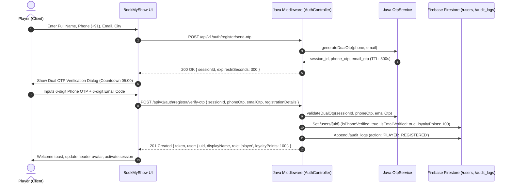
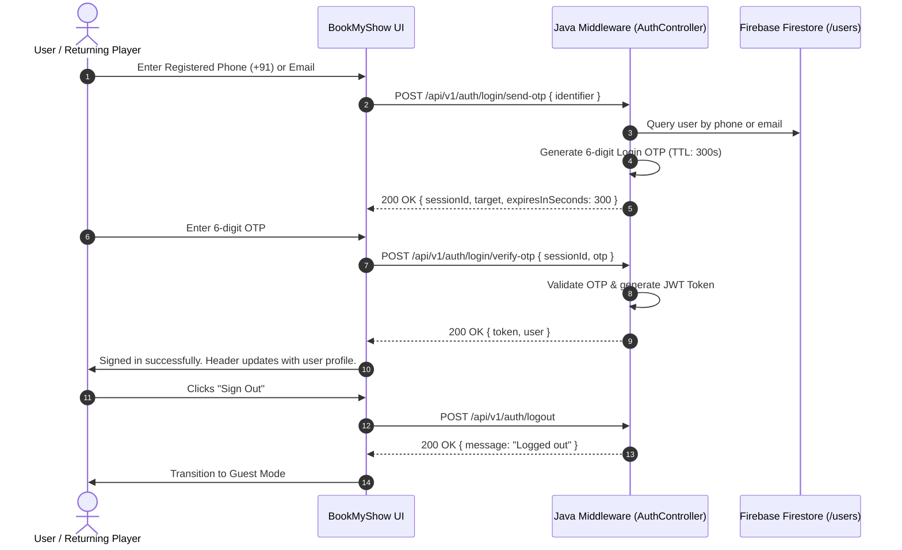
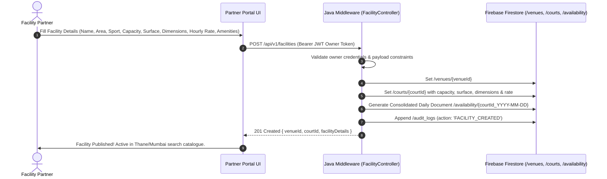
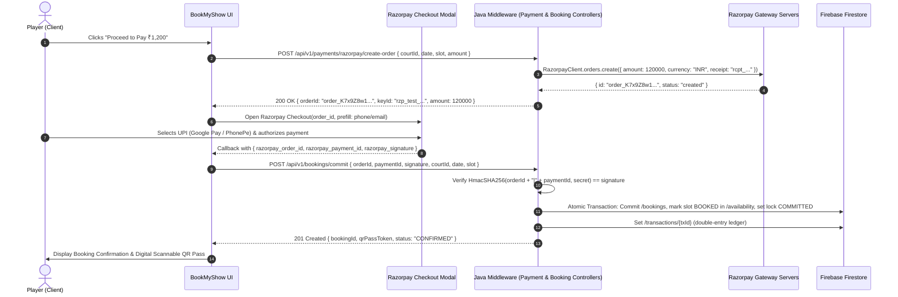

# Project Apex — Technical Specification: Java Spring Boot Middleware & Hosted Firebase Persistence
**Document Version:** 2.0.0  
**Target Architecture:** 3-Tier Enterprise Architecture (Web UI ⇄ Java Middleware ⇄ Hosted Firebase Firestore)  
**Target Metros:** Thane, Mumbai, Navi Mumbai  
**Governing Agent:** Spec Kitty Multi-Agent Orchestrator (`apex-pm`, `apex-backend`, `apex-database`)  
**Status:** Architecture Approved for Execution  

---

## 1. Executive Summary & 3-Tier Architecture Blueprint

Project Apex is migrating from a client-direct simulation model to a production-grade **3-Tier Enterprise Architecture**:
1. **Tier 1 (Presentation Layer):** Responsive BookMyShow & Snabbit styled Web/PWA frontend communicating with the middleware via secure JSON REST APIs and hosting Razorpay Checkout.
2. **Tier 2 (Application & Middleware Layer):** Java 21 LTS + Spring Boot 3.2.x REST application encapsulating business logic, Dual OTP generation/verification, 5-minute atomic concurrency slot leases, dynamic pricing calculations, Razorpay payment lifecycle, and audit telemetry.
3. **Tier 3 (Persistence & Data Layer):** Hosted Cloud Firestore (`project-apex-pushp`) managed via Google Cloud Firestore / Firebase Admin Java SDK, maintaining the 8-collection architecture with atomic database transactions.

```mermaid
flowchart TD
    subgraph Tier1["Tier 1: Presentation Layer (Web & PWA)"]
        UI["BookMyShow / Snabbit UI (HTML5, Tailwind, ES Modules)"]
        RazorpayModal["Razorpay Standard Checkout SDK"]
        APIClient["API Client Service (src/services/apiClient.js)"]
        UI <--> APIClient
        UI --> RazorpayModal
    end

    subgraph Tier2["Tier 2: Middleware Layer (Java 21 / Spring Boot 3.x)"]
        AuthCtrl["AuthController\n(/api/v1/auth)"]
        UserCtrl["UserController\n(/api/v1/users)"]
        VenueCtrl["VenueController\n(/api/v1/venues)"]
        FacilityCtrl["FacilityController\n(/api/v1/facilities)"]
        SlotCtrl["SlotController\n(/api/v1/slots)"]
        BookingCtrl["BookingController\n(/api/v1/bookings)"]
        PaymentCtrl["PaymentController\n(/api/v1/payments)"]
        GateCtrl["GateController\n(/api/v1/gate)"]

        AuthSvc["Auth & Dual OTP Service"]
        ConcurrencySvc["5-Min Concurrency Lease Manager"]
        PricingEngine["Dynamic Off-Peak / Odd-Hour Engine"]
        RazorpaySvc["Razorpay Java SDK (Order & HMAC SHA256)"]
        BookingSvc["Atomic Multi-Doc Booking Coordinator"]
        CancellationSvc["3-Tier Refund Policy Calculator"]

        AuthCtrl --> AuthSvc
        UserCtrl --> AuthSvc
        VenueCtrl --> VenueSvc["Venue & Facility Service"]
        FacilityCtrl --> VenueSvc
        SlotCtrl --> ConcurrencySvc
        SlotCtrl --> PricingEngine
        BookingCtrl --> BookingSvc
        BookingCtrl --> CancellationSvc
        PaymentCtrl --> RazorpaySvc
        GateCtrl --> BookingSvc
    end

    subgraph Tier3["Tier 3: Hosted Firebase Cloud Firestore (project-apex-pushp)"]
        FirestoreAdmin["Firebase Admin SDK / Google Cloud Firestore"]
        UsersCol[("/users")]
        VenuesCol[("/venues")]
        FacilitiesCol[("/courts")]
        AvailabilityCol[("/availability")]
        LocksCol[("/concurrency_locks")]
        BookingsCol[("/bookings")]
        TxCol[("/transactions")]
        AuditCol[("/audit_logs")]

        Tier2 <--> FirestoreAdmin
        FirestoreAdmin <--> UsersCol
        FirestoreAdmin <--> VenuesCol
        FirestoreAdmin <--> FacilitiesCol
        FirestoreAdmin <--> AvailabilityCol
        FirestoreAdmin <--> LocksCol
        FirestoreAdmin <--> BookingsCol
        FirestoreAdmin <--> TxCol
        FirestoreAdmin <--> AuditCol
    end

    APIClient <== "HTTPS / JSON REST" ==> Tier2
    RazorpayModal <== "Payment Webhook / Verification" ==> PaymentCtrl
```



---

## 2. Complete Workflow Specifications & Sequence Diagrams

### Workflow 1: User (Player) Registration with Dual OTP Verification
- **Objective:** Provision a verified player profile requiring validation of both Mobile (+91 Indian phone) and Email address.
- **Rules:**
  1. Mandatory fields: `displayName`, `phone` (10-digit Indian mobile), `email` (valid RFC 5322), `city`.
  2. Middleware dispatches two 6-digit numeric codes with 5-minute (300s) TTL:
     - Phone OTP via SMS Gateway
     - Email Verification Code via SMTP/SendGrid
  3. User enters both OTPs. Backend verifies atomically; upon success, writes user to Firestore `/users/{uid}`, awards 100 welcome loyalty points, appends `USER_REGISTERED` audit log, and returns JWT session token.



---

### Workflow 2: User Login & Logout Flow
- **Objective:** Secure, passwordless mobile/email OTP authentication and session termination.
- **Login Steps:**
  1. User inputs registered Mobile (+91) or Email.
  2. Middleware verifies existence in `/users`, generates 6-digit OTP code (5-min TTL), and records session.
  3. User enters 6-digit code. Middleware verifies, issues JWT authentication token with claims (`uid`, `role`, `displayName`), and sets active session.
- **Logout Steps:**
  1. Client sends `POST /api/v1/auth/logout`.
  2. Middleware invalidates JWT / session cache, records `USER_LOGGED_OUT` in `/audit_logs`.
  3. Client clears local session storage, transitions UI into Guest Mode.



---

### Workflow 3 & 4: Facility Owner Registration & Adding New Facilities
- **Objective:** Onboard sports facility owners and allow them to register multiple sports arenas with granular capacity, surfaces, dimensions, base rates, and operating schedules.
- **Facility Attributes Supported:**
  - `facilityType` / `sport`: Box Cricket, Turf Football, Indoor Badminton, Pickleball, Tennis, Squash, Swimming.
  - `capacity`: Maximum player capacity (e.g. 16 players for 8v8 Box Cricket, 10 players for 5v5 Football, 4 players for Doubles Badminton).
  - `dimensions`: Standard dimensions (e.g. `115ft x 65ft`, `120ft x 70ft`, `44ft x 20ft`).
  - `surface`: Certified turf surface (e.g., `15mm Monofilament Synthetic Turf`, `50mm Rubber Infill AstroTurf`, `BWF Teakwood Flooring`).
  - `amenities`: Floodlights, AC Dugouts, Changing Rooms, Locker Facilities, Valet Parking, Equipment Rental.
  - `pricing`: Base hourly rate, prime-time peak rate, dynamic odd-hour discount percentage (up to 35%).



---

### Workflow 5 & 6: Slot Discovery, Dynamic Pricing & 5-Minute Concurrency Lock
- **Objective:** Eliminate double-booking race conditions in high-demand metros (Thane, Bandra, BKC) with a 5-minute atomic check-and-set reservation lease.
- **Execution Protocol:**
  1. Client queries `/api/v1/slots?courtId={id}&date={YYYY-MM-DD}`. Middleware loads consolidated daily doc (1 read).
  2. Middleware computes odd-hour pricing (-35% for 12:00-16:00, -25% for 22:00-02:00, +20% for 18:00-22:00 peak).
  3. User selects slot. Client requests lock `POST /api/v1/slots/lock`.
  4. Middleware executes an atomic check-and-set transaction on `/concurrency_locks/{courtId_date_slot}`:
     - If lock does not exist or expired (`expiresAt < now`), acquire lock with `status: "HELD"`, `expiresAt: now + 300000ms`, `userId`.
     - If lock exists and valid (`expiresAt >= now` and `userId != requester`), reject with HTTP 409 Conflict: `"Slot currently reserved by another player"`.

---

### Workflow 7 & 8: Razorpay Payment Gateway Integration & Atomic Booking Commit
- **Objective:** Secure, seamless payment processing using Razorpay followed by cryptographic digital QR pass issuance.
- **Payment Lifecycle:**
  1. **Order Creation:** Client requests `POST /api/v1/payments/razorpay/create-order` with `bookingContext` (locked slot, total amount). Middleware calls Razorpay Orders API (`client.orders.create`) and returns `razorpayOrderId`.
  2. **Client Checkout:** Web UI opens Razorpay Standard Checkout modal with `order_id`, key, user phone/email. Player completes payment (UPI, Card, NetBanking).
  3. **Signature Verification:** Razorpay returns `razorpay_payment_id`, `razorpay_order_id`, `razorpay_signature`. Client submits them to `POST /api/v1/bookings/commit`.
  4. **Cryptographic Verification:** Middleware computes HMAC SHA256 of `order_id + "|" + payment_id` using Razorpay Key Secret. If match:
     - Writes `/bookings/{bookingId}` with status `CONFIRMED`.
     - Updates `/availability/{courtId_date}` slot status to `BOOKED`.
     - Updates `/concurrency_locks` status to `COMMITTED`.
     - Generates scannable QR Pass Token `APEX-{CITY}-{DATE}-{HASH}`.
     - Credits player loyalty points (+50 pts).



---

### Workflow 9 & 10: 3-Tier Cancellation & Gate QR Scanner
- **Workflow 9 (Cancellations):** Automated refund computation:
  - `> 24 hours` before match: Tier 1 (100% refund minus ₹50 payment gateway handling fee).
  - `12 - 24 hours` before match: Tier 2 (50% refund).
  - `< 12 hours` before match: Tier 3 (0% refund, slot forfeited).
  - Razorpay refund initiated via `razorpayClient.payments.refund(paymentId, refundPayload)`.
- **Workflow 10 (Gate Scanner):** Facility owner scans player's QR Pass Token:
  - `POST /api/v1/gate/verify-pass { qrPassToken }`.
  - Middleware verifies token validity, checks if already redeemed or cancelled, transitions status to `CHECKED_IN`, and records entry timestamp.

---

## 3. Java Spring Boot Application Architecture

### 3.1 Technology Stack & Dependencies (`pom.xml`)
- **Runtime:** Java 21 LTS (`Eclipse Adoptium OpenJDK 21`)
- **Framework:** Spring Boot 3.2.3 (`org.springframework.boot:spring-boot-starter-web`)
- **Validation:** `org.springframework.boot:spring-boot-starter-validation` (Jakarta Validation)
- **Security & JWT:** `io.jsonwebtoken:jjwt-api:0.12.5`, `jjwt-impl`, `jjwt-jackson`
- **Firebase Persistence:** `com.google.firebase:firebase-admin:9.2.0` (or `com.google.cloud:google-cloud-firestore:3.18.0`)
- **Payment Gateway:** `com.razorpay:razorpay-java:1.4.3`
- **Utility:** Lombok / Jackson Databind

### 3.2 Java Package Hierarchy
```
backend/
├── pom.xml
└── src/
    ├── main/
    │   ├── java/com/projectapex/
    │   │   ├── ProjectApexApplication.java
    │   │   ├── config/
    │   │   │   ├── FirebaseConfig.java
    │   │   │   ├── RazorpayConfig.java
    │   │   │   ├── CorsConfig.java
    │   │   │   └── SecurityConfig.java
    │   │   ├── controller/
    │   │   │   ├── AuthController.java
    │   │   │   ├── UserController.java
    │   │   │   ├── VenueController.java
    │   │   │   ├── FacilityController.java
    │   │   │   ├── SlotController.java
    │   │   │   ├── BookingController.java
    │   │   │   ├── PaymentController.java
    │   │   │   └── GateController.java
    │   │   ├── dto/
    │   │   │   ├── request/
    │   │   │   │   ├── RegisterPlayerRequest.java
    │   │   │   │   ├── RegisterOwnerRequest.java
    │   │   │   │   ├── VerifyOtpRequest.java
    │   │   │   │   ├── CreateFacilityRequest.java
    │   │   │   │   ├── AcquireLockRequest.java
    │   │   │   │   ├── CreateRazorpayOrderRequest.java
    │   │   │   │   └── CommitBookingRequest.java
    │   │   │   └── response/
    │   │   │       ├── AuthResponse.java
    │   │   │       ├── SlotAvailabilityResponse.java
    │   │   │       ├── RazorpayOrderResponse.java
    │   │   │       └── BookingResponse.java
    │   │   ├── model/
    │   │   │   ├── UserRecord.java
    │   │   │   ├── VenueRecord.java
    │   │   │   ├── FacilityRecord.java
    │   │   │   ├── AvailabilityDoc.java
    │   │   │   ├── ConcurrencyLock.java
    │   │   │   ├── BookingRecord.java
    │   │   │   └── TransactionRecord.java
    │   │   ├── service/
    │   │   │   ├── AuthService.java
    │   │   │   ├── OtpService.java
    │   │   │   ├── VenueService.java
    │   │   │   ├── ConcurrencyService.java
    │   │   │   ├── PricingService.java
    │   │   │   ├── RazorpayService.java
    │   │   │   ├── BookingService.java
    │   │   │   └── GateService.java
    │   │   └── repository/
    │   │       ├── FirestoreUserRepository.java
    │   │       ├── FirestoreVenueRepository.java
    │   │       ├── FirestoreAvailabilityRepository.java
    │   │       ├── FirestoreLockRepository.java
    │   │       └── FirestoreBookingRepository.java
    │   └── resources/
    │       ├── application.properties
    │       └── firebase-service-account.json (or environment variable config)
    └── test/
        └── java/com/projectapex/
            ├── AuthWorkflowIntegrationTest.java
            ├── ConcurrencyLockTest.java
            ├── PricingEngineTest.java
            └── BookingCommitTest.java
```

---

## 4. REST API Endpoint Specifications

| HTTP Verb | Endpoint Path | Description | Access Role |
| :--- | :--- | :--- | :--- |
| `POST` | `/api/v1/auth/register/send-otp` | Dispatches dual 6-digit OTPs to mobile and email | Public |
| `POST` | `/api/v1/auth/register/verify-otp` | Verifies dual OTPs & provisions user profile | Public |
| `POST` | `/api/v1/auth/login/send-otp` | Dispatches 6-digit login OTP | Public |
| `POST` | `/api/v1/auth/login/verify-otp` | Validates login OTP and issues JWT | Public |
| `POST` | `/api/v1/auth/logout` | Invalidates active user session | Authenticated |
| `GET` | `/api/v1/users/me` | Fetches active user profile & loyalty points | Authenticated |
| `GET` | `/api/v1/venues` | Lists venues filtered by city and sport | Public |
| `POST` | `/api/v1/facilities` | Adds new sports facility (capacity, surface, rate) | Facility Owner |
| `GET` | `/api/v1/slots` | Retrieves consolidated daily slot availability | Public |
| `POST` | `/api/v1/slots/lock` | Acquires 5-minute atomic reservation lock | Authenticated |
| `DELETE` | `/api/v1/slots/lock` | Releases reservation lock | Authenticated |
| `POST` | `/api/v1/payments/razorpay/create-order` | Creates order with Razorpay Orders API | Authenticated |
| `POST` | `/api/v1/bookings/commit` | Verifies Razorpay HMAC signature & commits booking | Authenticated |
| `GET` | `/api/v1/bookings/my-passes` | Retrieves exclusively the logged-in user's passes | Authenticated |
| `POST` | `/api/v1/bookings/{id}/cancel` | Calculates refund tier & processes cancellation | Authenticated |
| `POST` | `/api/v1/gate/verify-pass` | Scans and validates player QR Pass Token | Facility Owner |
| `POST` | `/api/v1/gate/walk-in` | Books counter walk-in reservation with cash settlement | Facility Owner |

---

## 5. Security & Multi-Tenant Data Isolation
- **Authentication:** Stateless Bearer JWT tokens containing subject UID, role (`player` vs `venue_owner`), and cryptographic signature.
- **Data Isolation:** `GET /api/v1/bookings/my-passes` extracts UID directly from the verified JWT claims, guaranteeing zero leakage of other players' bookings.
- **Concurrency Protection:** Check-and-set atomic locks on `/concurrency_locks/{courtId_date_slot}` prevent simultaneous checkout attempts.
- **Financial Integrity:** Double-entry ledger on `/transactions` tracking Razorpay Payment IDs and refund transfers.
