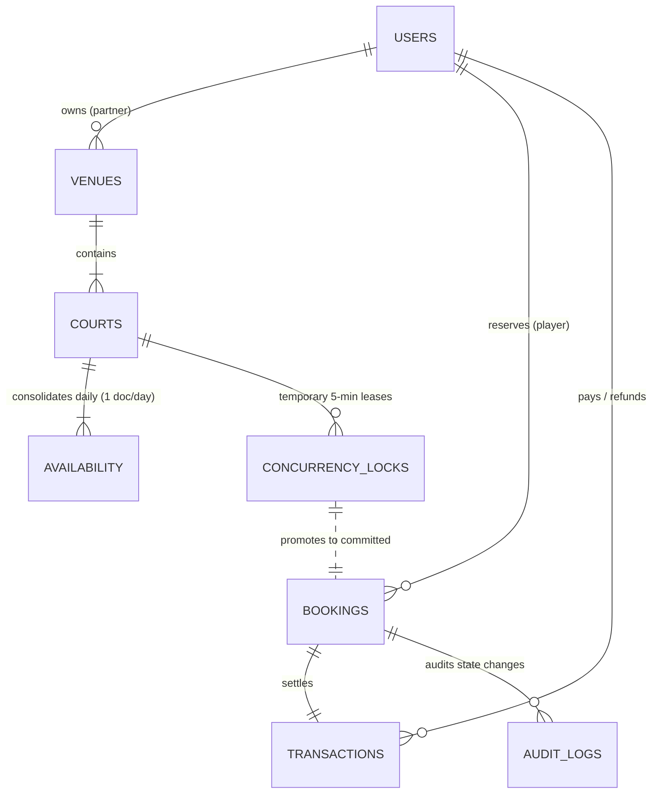
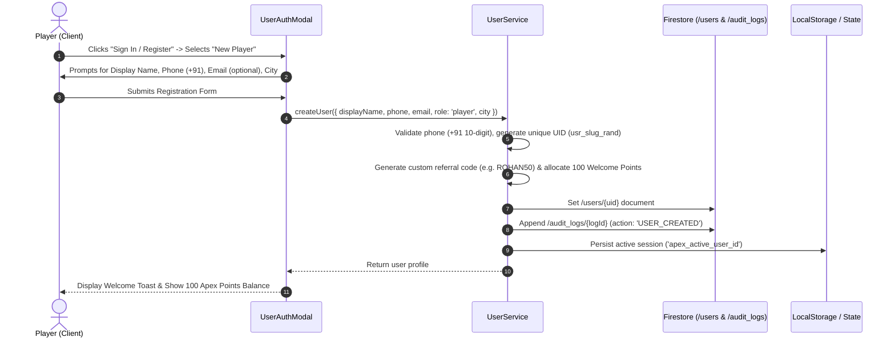
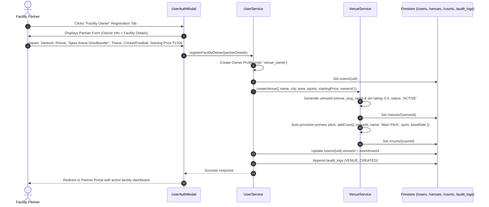
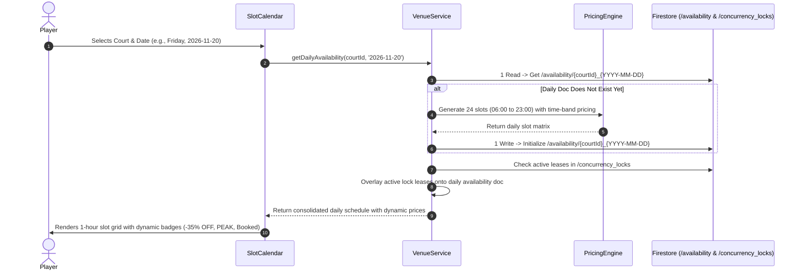
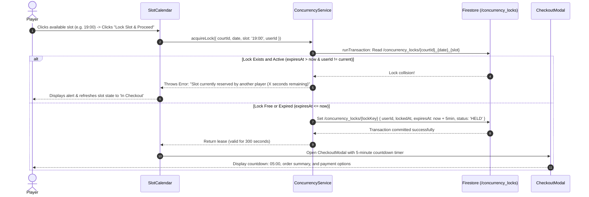
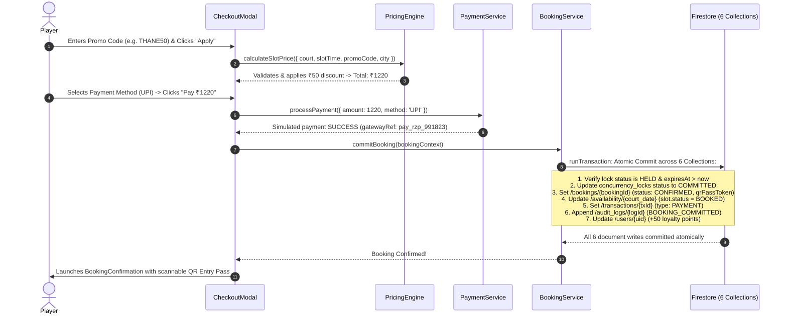
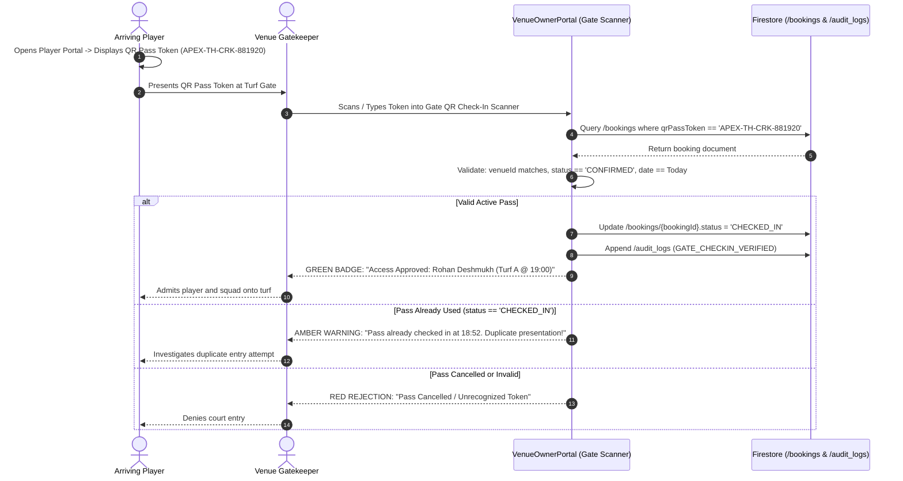
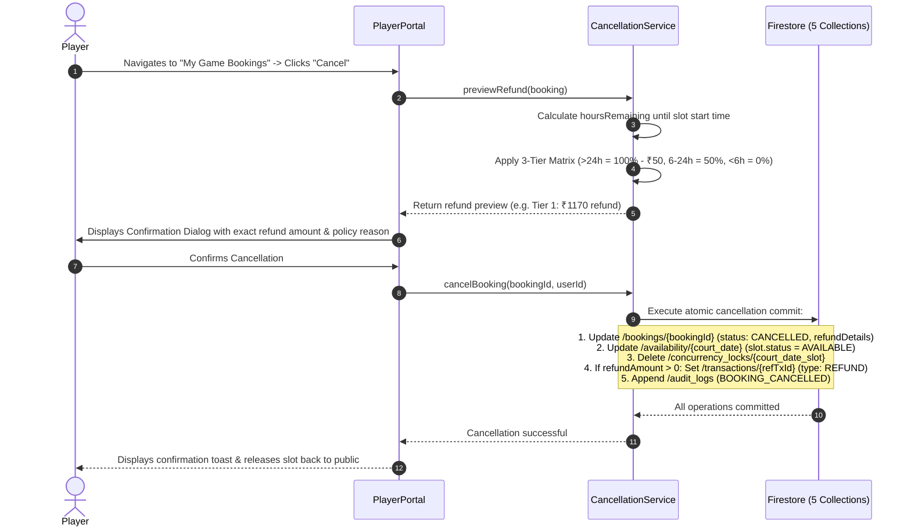
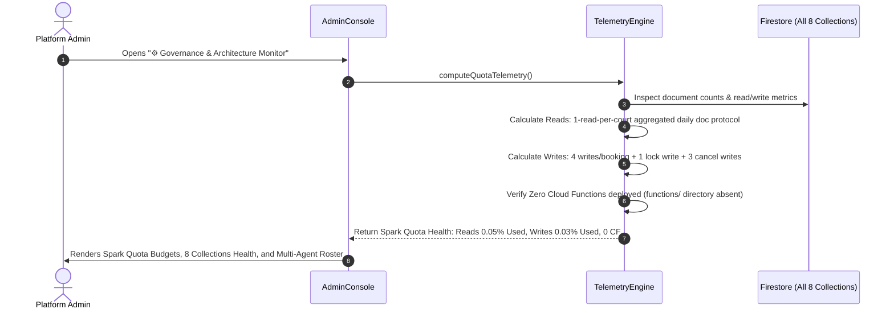

# Master Business Analyst Specification: Comprehensive Call Workflows & End-to-End Business Scenarios
**Platform:** Project Apex — Unified Sports Facility Booking Platform  
**Target Geos:** Thane, Mumbai Suburbs, South/Central Mumbai, Navi Mumbai  
**Mission Slug:** `001-project-apex-mvp`  
**Governing Agent:** `apex-ba` (Business Analyst)  
**Coordinating Agents:** `apex-pm`, `apex-database`, `apex-backend`, `apex-frontend`, `apex-deployment`  
**Architecture Mandate:** Firebase Spark Free Tier (<50,000 daily reads, <20,000 daily writes, 0 Cloud Functions)  
**Status:** Approved Master Specification  

---

## Executive Summary & Architecture Blueprint

Project Apex is a high-performance, multi-tenant sports facility scheduling and booking platform engineered for dense Indian metropolitan areas (specifically Thane and Mumbai MMR). The system provides seamless real-time turf discovery, transparent dynamic odd-hour pricing, 5-minute atomic reservation locking, scannable QR gate passes, and automated 3-tier cancellation workflows.

The entire architecture is intentionally engineered to operate with **Zero Cloud Functions** on the **Firebase Spark (Free) Tier** without risking concurrency collisions, overselling, or quota exhaustion.

### The 8-Collection Relational Firestore Architecture

Every business workflow in Project Apex maps directly into eight core Firestore collections:



| Collection Name | Document Path Template | Primary Purpose | Scalability & Quota Strategy |
| :--- | :--- | :--- | :--- |
| **`users`** | `/users/{uid}` | Player and Venue Owner profiles, roles, loyalty balances | Read on auth, cached locally in memory |
| **`venues`** | `/venues/{venueId}` | Facility catalog, location, amenities, geo coordinates | Cached in IndexedDB (24-hour TTL) |
| **`courts`** | `/courts/{courtId}` | Specific turfs/pitches, sports, dimensions, base rates | Filtered by `venueId`, cached alongside venue |
| **`availability`** | `/availability/{courtId}_{YYYY-MM-DD}` | Consolidated daily schedule (all 24 1-hour slots) | **1 read per court per day** (eliminates 24 reads/day) |
| **`concurrency_locks`** | `/concurrency_locks/{courtId}_{date}_{slot}` | 5-minute atomic check-and-set reservation leases | Ephemeral documents with automated client-side TTL |
| **`bookings`** | `/bookings/{bookingId}` | Immutable match bookings with cryptographic QR tokens | Read on demand per user/venue; permanent ledger |
| **`transactions`** | `/transactions/{txId}` | Double-entry financial ledger (payments & refunds) | Append-only financial tracking |
| **`audit_logs`** | `/audit_logs/{logId}` | Security audit trail for compliance, locks, and cancellations | Append-only security log |

---

## Master Workflow Index

1. [Workflow 1: User (Player) Registration & Welcome Onboarding Flow](#workflow-1-user-player-registration--welcome-onboarding-flow)
2. [Workflow 2: Facility Owner (Partner) Registration & Facility Auto-Provisioning Flow](#workflow-2-facility-owner-partner-registration--facility-auto-provisioning-flow)
3. [Workflow 3: Adding / Customizing a Sports Facility (Turfs & Courts) Flow](#workflow-3-adding--customizing-a-sports-facility-turfs--courts-flow)
4. [Workflow 4: Dynamic Slot Discovery & Odd-Hour Pricing Engine Flow](#workflow-4-dynamic-slot-discovery--odd-hour-pricing-engine-flow)
5. [Workflow 5: Two-Phase Slot Reservation & Concurrency Lock Acquisition Flow](#workflow-5-two-phase-slot-reservation--concurrency-lock-acquisition-flow)
6. [Workflow 6: Checkout, Simulated Payment & Atomic Booking Commit Flow](#workflow-6-checkout-simulated-payment--atomic-booking-commit-flow)
7. [Workflow 7: Venue Gate QR Check-In & Attendance Verification Flow](#workflow-7-venue-gate-qr-check-in--attendance-verification-flow)
8. [Workflow 8: 3-Tier Cancellation & Automated Refund Calculation Flow](#workflow-8-3-tier-cancellation--automated-refund-calculation-flow)
9. [Workflow 9: Facility Owner Walk-in / Phone Reservation & Slot Blocking Flow](#workflow-9-facility-owner-walk-in--phone-reservation--slot-blocking-flow)
10. [Workflow 10: Quota Telemetry & Spark Free Tier Compliance Flow](#workflow-10-quota-telemetry--spark-free-tier-compliance-flow)

---

## Workflow 1: User (Player) Registration & Welcome Onboarding Flow

### 1.1 Actor & Preconditions
- **Primary Actor:** Casual Player or Tournament Organizer (e.g., Rohan, 27, Thane West).
- **Secondary Actor:** System Authentication Layer (`UserService`).
- **Preconditions:**
  - Player accesses the application via mobile browser or PWA.
  - Player has an active Indian mobile number (+91) and device with local storage support.

### 1.2 Sequence Diagram


### 1.3 Step-by-Step Sequence & State Mutations
1. **Trigger:** Player opens `UserAuthModal` and selects the "New Player" tab.
2. **Form Entry & Client Validation:**
   - `displayName`: Minimum 2 characters, trimmed.
   - `phone`: Standardized Indian mobile format (`+91` prefix optional, validated for 10 digits).
   - `email`: If omitted, automatically derived as `{firstname}.{random}@apex.dev`.
   - `city`: Standardized to metropolitan cluster (`Thane`, `Mumbai`, `Navi Mumbai`).
3. **Data Generation:**
   - Document ID: `usr_{slug}_{random4}` (e.g., `usr_rohan_deshmukh_4819`).
   - Referral Code: First name uppercase up to 5 characters + 2-digit integer (e.g., `ROHAN82`).
   - Welcome Incentive: Initial `loyaltyPoints` credited with `100` points.
4. **Database Mutation:**
   - Creates document at `/users/{uid}` with:
     ```json
     {
       "uid": "usr_rohan_deshmukh_4819",
       "displayName": "Rohan Deshmukh",
       "email": "rohan.deshmukh@apex.dev",
       "phone": "+919820199182",
       "role": "player",
       "city": "Thane",
       "loyaltyPoints": 100,
       "referralCode": "ROHAN82",
       "venueId": null,
       "createdAt": 1795000000000,
       "updatedAt": 1795000000000
     }
     ```
   - Appends audit log to `/audit_logs/audit_{timestamp}` with action `USER_CREATED`.
5. **Session Initiation:**
   - Writes `apex_active_user_id` to browser `localStorage`.
   - System updates application-wide header rendering player initials, role badge, and loyalty balance.

### 1.4 State Transitions & Collections Impacted
- **`users`:** State transitioned from Non-existent to `ACTIVE` (1 write).
- **`audit_logs`:** Append-only security audit log entry created (1 write).

### 1.5 Error Handling & Edge Cases
- **Missing Required Fields:** Modal prevents submission and highlights invalid input in red border with specific error feedback message.
- **Duplicate Phone Number:** Client searches existing cached users; if phone exists, presents 1-click option to "Sign In as existing user" rather than creating an orphaned duplicate.
- **Offline / Transient Connectivity:** State is queued in IndexedDB offline storage (`offlineStorage.js`) and synchronized upon connection restoration.

### 1.6 Postconditions & Success Criteria
- User profile exists in Firestore collection `/users`.
- Active user session points to the new player.
- Player has 100 loyalty points available to redeem during checkout.
- Success verified when user can immediately browse venues and initiate bookings.

---

## Workflow 2: Facility Owner (Partner) Registration & Facility Auto-Provisioning Flow

### 2.1 Actor & Preconditions
- **Primary Actor:** Turf / Sports Facility Owner (e.g., Santosh, 45, Ghodbunder Rd, Thane).
- **Secondary Actor:** Platform Venue Provisioner (`VenueService`).
- **Preconditions:**
  - Facility partner wants to list a commercial sports arena (box cricket, football turf, badminton court).
  - Venue has a physical address within Thane, Mumbai, or Navi Mumbai.

### 2.2 Sequence Diagram


### 2.3 Step-by-Step Sequence & State Mutations
1. **Partner Onboarding Initiation:**
   - Owner accesses `UserAuthModal` -> selects "🏢 Facility Owner" tab or clicks "+ Add Facility" in navigation.
2. **Input Ingestion & Validation:**
   - Owner Details: Name (`Santosh Patil`), Phone (`+919811223344`), Email.
   - Facility Details: Facility Name (`Apex Arena Ghodbunder`), Area (`Ghodbunder Road`), City (`Thane`), Base Starting Price (`₹1,200/hr`), Sports supported (`Cricket`, `Football`), Standard Amenities (`Floodlights`, `Changing Rooms`, `Parking`, `Dugout`).
3. **Owner Profile Creation:**
   - Generates `usr_santosh_patil_{random4}` in `/users/{uid}` with `role: "venue_owner"`.
4. **Automated Venue Provisioning:**
   - Creates document `/venues/{venueId}`:
     ```json
     {
       "venueId": "venue_apex_arena_ghodbunder_412",
       "name": "Apex Arena Ghodbunder",
       "ownerId": "usr_santosh_patil_8812",
       "city": "Thane",
       "area": "Ghodbunder Road",
       "address": "Ghodbunder Road, Thane, Maharashtra",
       "coordinates": { "lat": 19.2345, "lng": 72.9781 },
       "sports": ["cricket", "football"],
       "amenities": ["Floodlights", "Changing Rooms", "Parking", "Dugout"],
       "rating": 5.0,
       "reviewsCount": 1,
       "startingPrice": 1200,
       "featured": true,
       "status": "ACTIVE",
       "createdAt": 1795000000000
     }
     ```
5. **Default Court Auto-Provisioning:**
   - System automatically provisions the venue's first active court `/courts/{courtId}`:
     - Name: `Apex Arena Ghodbunder Main Pitch`
     - Sport: `cricket`
     - Base Hourly Rate: `₹1,200`
     - Peak Hourly Rate: `₹1,560` (1.3x multiplier)
     - Odd-Hour Discount: `35%` off
6. **Cross-Link & Audit Commit:**
   - Backlinks `venueId` to owner profile `/users/{uid}.venueId`.
   - Records `VENUE_CREATED` in `/audit_logs`.
7. **Portal Route:** Owner is instantly redirected into the Partner Management Portal.

### 2.4 State Transitions & Collections Impacted
- **`users`:** Owner user created with role `venue_owner` (1 write) and subsequently linked with `venueId` (1 write).
- **`venues`:** New multi-tenant facility document created in status `ACTIVE` (1 write).
- **`courts`:** Primary default turf provisioned (1 write).
- **`audit_logs`:** Audit log recorded (1 write).

### 2.5 Error Handling & Edge Cases
- **Missing Turf Details:** Required field validation halts form submission if turf name or locality is blank.
- **Slug Collision:** Random 3-digit entropy suffix appended to slug ensures multi-tenant uniqueness even for identical turf names (e.g. `venue_turf_club_102` vs `venue_turf_club_941`).
- **Owner Abort / Browser Refresh:** If form is closed midway, no orphaned court or venue is created; full operation runs in cohesive sequential service execution.

### 2.6 Postconditions & Success Criteria
- Partner account is authenticated and loaded as active user.
- Venue immediately shows up in public `VenueExplorer` when filtered by City or Sport.
- Partner Portal displays zero double-booking assurance, revenue meters, and schedule calendar.

---

## Workflow 3: Adding / Customizing a Sports Facility (Turfs & Courts) Flow

### 3.1 Actor & Preconditions
- **Primary Actor:** Authenticated Facility Owner or Platform Admin.
- **Secondary Actor:** `VenueService`, `AddVenueModal`.
- **Preconditions:**
  - Owner is logged in with valid `ownerId` and assigned venue.
  - Facility physical expansion requires adding additional courts (e.g., adding Badminton Court or Pickleball Turf).

### 3.2 Sequence Diagram
```mermaid
sequenceDiagram
    autonumber
    actor Owner as Venue Owner
    participant Modal as AddVenueModal
    participant VenueSvc as VenueService
    participant Firestore as Firestore (/courts, /venues, /audit_logs)

    Owner->>Modal: Clicks "+ Add New Pitch / Court" in Partner Portal
    Modal->>Owner: Prompts for Court Name, Sport Type, Surface, Dimensions, Pricing
    Owner->>Modal: Submits: "Court B - Synthetic Badminton", Badminton, Wooden, ₹800/hr, Peak ₹1000/hr, Odd-hour 30%
    Modal->>VenueSvc: addCourt({ venueId, name, sport, surface, dimensions, baseHourlyRate, peakHourlyRate, oddHourDiscountPct })
    VenueSvc->>VenueSvc: Validate rates (base > 0, peak >= base, discount <= 50%)
    VenueSvc->>VenueSvc: Generate courtId: court_{venueId}_{slug}_{rand}
    VenueSvc->>Firestore: Set /courts/{courtId}
    VenueSvc->>Firestore: Append /audit_logs (COURT_CREATED)
    VenueSvc-->>Modal: Return court data
    Modal-->>Owner: Live preview refreshed; new court tab visible in schedule
```

### 3.3 Step-by-Step Sequence & State Mutations
1. **Trigger:** Owner opens Partner Portal and clicks "+ Add New Facility" or chooses to expand courts within their existing venue.
2. **Court Parameter Configuration:**
   - `name`: e.g., "Turf 2 - 7v7 Artificial Football Pitch".
   - `sport`: Selected from canonical taxonomy (`cricket`, `football`, `badminton`, `pickleball`, `squash`, `tennis`).
   - `surface`: Synthetic turf, acrylic hard court, wooden sprung floor, or clay.
   - `dimensions`: Standard sizing string (e.g., `120ft x 70ft`).
   - `baseHourlyRate`: Base INR price (e.g., `₹1,400`).
   - `peakHourlyRate`: Weekend & evening rate (e.g., `₹1,800`).
   - `oddHourDiscountPct`: Off-peak discount rate (e.g., `30%`).
3. **Validation Rules:**
   - `baseHourlyRate > 0`.
   - `peakHourlyRate >= baseHourlyRate`.
   - `0 <= oddHourDiscountPct <= 50`.
4. **Database Insertion:**
   - Creates document `/courts/{courtId}`:
     ```json
     {
       "courtId": "court_venue_thane_01_turf_2_7v7_881",
       "venueId": "venue_thane_01",
       "name": "Turf 2 - 7v7 Artificial Football Pitch",
       "sport": "football",
       "surface": "FIFA Quality Artificial Grass",
       "dimensions": "120ft x 70ft",
       "baseHourlyRate": 1400,
       "peakHourlyRate": 1800,
       "oddHourDiscountPct": 30,
       "isActive": true
     }
     ```
   - Appends audit log to `/audit_logs`.
5. **UI Synchronization:** Court tab immediately appears on both the Partner Portal schedule and player's `SlotCalendar`.

### 3.4 State Transitions & Collections Impacted
- **`courts`:** New court document created in status `isActive: true` (1 write).
- **`audit_logs`:** Audit log appended (1 write).

### 3.5 Error Handling & Edge Cases
- **Negative or Non-Numeric Price:** Form validation rejects invalid characters and alerts user.
- **Unauthorized Manipulation:** Firestore Security Rules verify that `request.auth.uid == resource.data.ownerId` before permitting court creation under a `venueId`.

### 3.6 Postconditions & Success Criteria
- New court is immediately discoverable.
- Daily availability documents dynamically initialize for this court upon first query.

---

## Workflow 4: Dynamic Slot Discovery & Odd-Hour Pricing Engine Flow

### 4.1 Actor & Preconditions
- **Primary Actor:** Casual Player searching for open slots.
- **Secondary Actor:** Dynamic Pricing Engine (`pricingEngine.js`) & Schedule Aggregator (`VenueService`).
- **Preconditions:**
  - Player has selected a venue and court.
  - Selected date is within the supported 7-day rolling schedule.

### 4.2 Sequence Diagram


### 4.3 Step-by-Step Sequence & State Mutations
1. **User Selection:** Player clicks on a venue card in `VenueExplorer`, enters `SlotCalendar`, and picks a date from the 7-day strip (e.g., `Today`, `Tomorrow`, or up to 7 days out).
2. **1-Read Consolidated Fetch (Read Minimization Protocol):**
   - Client calls `VenueService.getDailyAvailability(courtId, dateStr)`.
   - Reads a single document: `/availability/{courtId}_{YYYY-MM-DD}` containing all slots for that 24-hour day.
   - **Spark Tier Quota Protection:** Exactly **1 Firestore Read** is consumed for the entire day's 24 hours of availability, saving 23 redundant reads compared to naive sub-collections.
3. **Automated Initialization (Lazy Day Generation):**
   - If the day document does not yet exist, client evaluates `generateInitialDailyDoc`:
     - Loops hourly slots from `06:00` to `23:00`.
     - Calls `evaluateSlotTimeBand(slotTime)`.
4. **Time-Band Elasticity & Odd-Hour Discount Evaluation:**
   The dynamic pricing engine applies time-band rules:
   - **Early Bird Band (06:00 - 08:00):** 20% discount on base hourly rate.
   - **Afternoon Grind / Off-Peak (11:00 - 16:00, Weekdays):** 35% discount on base hourly rate.
   - **Night Owl Band (23:00 - 02:00):** 25% discount on base hourly rate.
   - **Prime Time Peak Band (19:00 - 23:00):** 1.2x peak multiplier.
   - **Standard Hours:** 1.0x base rate.
5. **Real-Time Lock Lease Overlay:**
   - Client checks whether any slot currently has an unexpired lease in `concurrency_locks/{courtId}_{date}_{slot}`.
   - If a lease is active (`expiresAt > now`), the slot's display status is temporarily mapped from `AVAILABLE` to `RESERVED` (`In Checkout`) with an amber indicator.
   - If a previous lease has expired (`expiresAt <= now`), the status remains `AVAILABLE`.
6. **Rendering:** Slots render with color-coded badges, crossed-out original prices, and current discounted prices.

### 4.4 State Transitions & Collections Impacted
- **`availability`:** Read 1 document. If initialized for the first time, written once (1 write).
- **`concurrency_locks`:** Read active locks for the selected court & date.
- **Zero Cloud Functions executed.**

### 4.5 Error Handling & Edge Cases
- **Date Boundary / Timezone Drift:** Client normalizes all dates and times to Indian Standard Time (IST, UTC+05:30) using explicit year, month, and day extraction to avoid midnight UTC flips.
- **Past Slots:** Any slot earlier than current local time for today's date is flagged as non-bookable (`PAST_SLOT`).

### 4.6 Postconditions & Success Criteria
- Player sees 100% accurate slot availability and pricing breakdown.
- Visual badge displays exact discount percentage (e.g., `-35%`).
- Quota consumed: exactly 1 Firestore document read.

---

## Workflow 5: Two-Phase Slot Reservation & Concurrency Lock Acquisition Flow

### 5.1 Actor & Preconditions
- **Primary Actor:** Authenticated Player selecting a desired match slot.
- **Secondary Actor:** Client Concurrency Lock Service (`ConcurrencyService`).
- **Preconditions:**
  - Desired slot is marked `AVAILABLE`.
  - Player is logged in with valid profile.

### 5.2 Sequence Diagram


### 5.3 Step-by-Step Sequence & State Mutations
1. **Slot Selection:** Player selects an available time slot (e.g., `19:00 - 20:00`) on Turf A and clicks "🔒 Lock Slot & Proceed (5-min Lease)".
2. **Transaction Execution (Phase 1 Atomic Check-and-Set):**
   - Deterministic Lock Key generated: `{courtId}_{YYYY-MM-DD}_{HH:MM}` (e.g., `court_thane_cricket_01_2026-11-20_19:00`).
   - Client executes Firestore atomic transaction `runTransaction(db, async (tx) => ...)`:
     ```javascript
     const lockRef = doc(db, 'concurrency_locks', lockKey);
     const lockSnap = await tx.get(lockRef);
     const now = Date.now();
     
     if (lockSnap.exists()) {
       const lockData = lockSnap.data();
       if (lockData.status === 'COMMITTED') {
         throw new Error("This slot has already been booked and confirmed.");
       }
       if (lockData.expiresAt > now && lockData.userId !== currentUser.uid) {
         const remainingSec = Math.ceil((lockData.expiresAt - now) / 1000);
         throw new Error(`Slot currently reserved by another player (${remainingSec}s checkout window remaining).`);
       }
     }
     
     // Acquire 5-minute lease
     tx.set(lockRef, {
       lockKey,
       courtId,
       date,
       slot,
       userId: currentUser.uid,
       lockedAt: now,
       expiresAt: now + 300000, // 5 minutes TTL
       status: 'HELD'
     });
     ```
3. **Lease Confirmation & Timer Hand-off:**
   - Transaction completes atomically.
   - Client launches `CheckoutModal` and starts an active countdown timer from `300` seconds (`05:00`).
   - If other concurrent users view this slot, it immediately appears disabled as `Reserved / In Checkout`.

### 5.4 State Transitions & Collections Impacted
- **`concurrency_locks`:** Document transition from `NONE` (or `EXPIRED`) to `HELD` (1 atomic write).
- **Other collections:** Unchanged during lock acquisition phase.

### 5.5 Error Handling & Edge Cases
- **Concurrent Click Race Condition (Two users click within 10ms):**
  - Firestore's optimistic concurrency control automatically forces one transaction to fail and retry. The winning transaction claims the lease; the losing transaction reads the updated lease and cleanly throws: `"Slot currently reserved by another player (300s checkout window remaining)"`. Double reservations are mathematically impossible.
- **Cart Abandonment / User Closes Tab:**
  - Zero Cloud Functions are needed to clean up abandoned locks. Any subsequent attempt to book the slot simply checks `expiresAt < now` and overwrites the stale lock document seamlessly.
- **User Intentionally Cancels Checkout:**
  - Clicking "Release Slot & Cancel" invokes `ConcurrencyService.releaseLock(...)` which deletes the `HELD` lock document immediately, returning the slot to `AVAILABLE` for everyone without waiting for TTL expiration.

### 5.6 Postconditions & Success Criteria
- Active user holds exclusive 5-minute lock lease on the slot.
- Countdown timer is running on client.
- No other player can checkout this slot during the lease window.

---

## Workflow 6: Checkout, Simulated Payment & Atomic Booking Commit Flow

### 6.1 Actor & Preconditions
- **Primary Actor:** Authenticated Player holding an active 5-minute lock lease.
- **Secondary Actors:** Dynamic Pricing Engine, Payment Gateway Service (`PaymentService`), Booking Transaction Service (`BookingService`).
- **Preconditions:**
  - Concurrency lock lease is active (`expiresAt > now`).
  - Checkout countdown timer has not expired.

### 6.2 Sequence Diagram


### 6.3 Step-by-Step Sequence & State Mutations
1. **Promo Code Application:**
   - Player inputs promo code: `THANE50` (Flat ₹50 off in Thane), `APEX20` (20% off up to ₹200), or `ODDHOUR35` (extra 10% stackable discount on odd hours).
   - `pricingEngine.js` enforces coupon eligibility rules:
     - Minimum spend threshold validation (e.g. min spend ₹500 for `THANE50`).
     - City restriction validation (e.g. valid only for Thane venues).
     - Odd-hour restriction (e.g. `ODDHOUR35` only valid on slots with `isOddHour === true`).
   - Summary updates: Base Rate - Odd Hour Discount - Promo Discount + Platform Convenience Fee (₹20) = Net Payable.
2. **Payment Processing:**
   - Player selects UPI, Card, or Net Banking and clicks "Pay ₹X".
   - `PaymentService.processPayment(...)` returns simulated payment success with transaction reference `pay_rzp_{timestamp}_{random}`.
3. **Phase 3: Multi-Document Atomic Commit (`runTransaction`):**
   Within a single atomic Firestore client transaction, the following 6 operations occur simultaneously:
   - **Step 3.1: Concurrency Verification:** Verifies `/concurrency_locks/{lockKey}` is held by `currentUser.uid` and `expiresAt > now`. If timed out, transaction aborts.
   - **Step 3.2: Lock Promotion:** Changes lock status from `HELD` to `COMMITTED` and records `bookingId`.
   - **Step 3.3: Booking Record Creation:** Creates `/bookings/{bookingId}` with:
     - `bookingId`: `bk_{YYYYMMDD}_{random6}`
     - `status`: `CONFIRMED`
     - `qrPassToken`: `APEX-{CITY}-{SPORT}-{RANDOM}` (e.g., `APEX-TH-CRK-881920`)
     - Complete itemized pricing snapshot and payment metadata.
   - **Step 3.4: Daily Schedule Slot Commitment:** Updates `/availability/{courtId}_{date}`:
     - `slots[slot].status = 'BOOKED'`
     - `slots[slot].bookingId = bookingId`
     - `slots[slot].userId = currentUser.uid`
     - `lastUpdated = Date.now()`
   - **Step 3.5: Ledger Transaction:** Writes to `/transactions/{txId}`:
     - `type`: `PAYMENT`
     - `amount`: total paid
     - `status`: `SUCCESS`
   - **Step 3.6: Audit Trail Entry:** Appends to `/audit_logs/{logId}` with action `BOOKING_COMMITTED`.
   - **Step 3.7: Loyalty Incentive:** Credits player with `+50` loyalty points in `/users/{uid}`.
4. **Confirmation Screen:**
   - Checkout modal closes; `BookingConfirmation` modal launches displaying:
     - High-contrast SVG/Canvas QR Code containing `qrPassToken`.
     - Match venue, turf, date, and slot confirmation.
     - 1-click "Add to Calendar" (.ics) action and Directions link.

### 6.4 State Transitions & Collections Impacted
- **`concurrency_locks`:** `HELD` -> `COMMITTED` (1 write).
- **`bookings`:** Created in status `CONFIRMED` (1 write).
- **`availability`:** Slot status updated from `AVAILABLE` -> `BOOKED` (1 write).
- **`transactions`:** New ledger document created (1 write).
- **`audit_logs`:** Audit log recorded (1 write).
- **`users`:** Loyalty points balance incremented by 50 (1 write).
- **Total:** 6 atomic writes executed in a single transaction.

### 6.5 Error Handling & Edge Cases
- **Checkout Window Timeout During Payment:** If user delays payment beyond the 5-minute lease, transaction checks `expiresAt < now`, rejects commit, and prompts user: `"Reservation window timed out. Please select the slot again."`
- **Network Disconnection During Commit:** Firestore client SDK handles offline queueing and automatic transaction retry upon reconnecting.
- **Payment Decline:** If payment fails, lock remains `HELD` until user retries or lease expires; no booking is created.

### 6.6 Postconditions & Success Criteria
- Slot is permanently locked and booked across all public schedules.
- Cryptographic QR pass token is generated and stored.
- Financial transaction and security audit records are permanently logged.
- Player's loyalty balance is updated.

---

## Workflow 7: Venue Gate QR Check-In & Attendance Verification Flow

### 7.1 Actor & Preconditions
- **Primary Actors:** Ground Gatekeeper / Turf Manager and Arriving Player.
- **Secondary Actor:** Gate Verification Scanner (`VenueOwnerPortal`).
- **Preconditions:**
  - Player has a valid `CONFIRMED` booking.
  - Match time is today (within entry window, typically slot start ± 30 minutes).

### 7.2 Sequence Diagram


### 7.3 Step-by-Step Sequence & State Mutations
1. **Pass Presentation:** Player opens Project Apex PWA -> "My Game Bookings" -> clicks "🎟️ View Pass". A scannable QR code and alphanumeric token (`APEX-TH-CRK-881920`) is displayed.
2. **Scanner Verification:**
   - Ground staff opens Partner Portal -> "Gate QR Code Check-In Scanner".
   - Gatekeeper scans QR code camera feed or enters token manually.
3. **Verification Logic:**
   - System queries `/bookings` matching `qrPassToken`.
   - Checks security conditions:
     - Does booking exist? (If no -> Reject).
     - Does `booking.venueId` match current facility? (If no -> Reject "Invalid Venue").
     - Is booking status `CONFIRMED`? (If `CHECKED_IN` -> Flag duplicate; if `CANCELLED` -> Reject).
4. **Attendance Commitment:**
   - Updates `/bookings/{bookingId}`:
     - `status`: `CHECKED_IN`
     - `checkedInAt`: `Date.now()`
   - Appends audit log to `/audit_logs`: action `GATE_CHECKIN_VERIFIED`.
5. **Gate Display:** Screen flashes green card with Player Name, Phone, Court Name, Match Time, and Payment Reference. Access is physically approved.

### 7.4 State Transitions & Collections Impacted
- **`bookings`:** Status transitions from `CONFIRMED` to `CHECKED_IN` (1 write).
- **`audit_logs`:** Audit log recorded (1 write).

### 7.5 Error Handling & Edge Cases
- **Duplicate Pass Sharing:** If a player takes a screenshot and shares it with multiple people, the first scan succeeds (`CHECKED_IN`), and any subsequent scan immediately alerts the gatekeeper: `"Pass already checked in at HH:MM:SS"`.
- **Cancelled Booking Presentation:** If a player cancelled for a refund but attempts to enter anyway, scanner flags: `"Cancelled & Refunded — Entry Prohibited"`.
- **Intermittent Ground Connectivity:** Gate scanner utilizes local cached booking index in PWA offline storage to verify tokens locally even during temporary cell tower dropouts.

### 7.6 Postconditions & Success Criteria
- Player and squad are authorized and admitted to court.
- Booking status updated to `CHECKED_IN`, preventing unauthorized reuse.
- Facility utilization and attendance confirmed.

---

## Workflow 8: 3-Tier Cancellation & Automated Refund Calculation Flow

### 8.1 Actor & Preconditions
- **Primary Actor:** Authenticated Player requesting cancellation.
- **Secondary Actor:** Cancellation & Refund Calculation Service (`CancellationService`).
- **Preconditions:**
  - Booking status is currently `CONFIRMED`.
  - Player owns the booking (`booking.userId === currentUser.uid`).

### 8.2 Sequence Diagram


### 8.3 Step-by-Step Sequence & State Mutations
1. **Cancellation Request:** Player views active booking in Player Portal and clicks "Cancel Booking".
2. **Policy Evaluation (`previewRefund`):**
   - Calculates time remaining: `hoursRemaining = (slotStartTime - Date.now()) / (1000 * 60 * 60)`.
   - Evaluates the **3-Tier Fair Refund Policy**:
     - **Tier 1 (> 24 hours prior to slot start):**
       - Refund: `100%` of amount paid minus ₹50 standard payment gateway reversal handling fee.
       - Formula: `refundAmount = Math.max(0, paidAmount - 50)`.
       - Reason: `"More than 24 hours notice. Full refund minus ₹50 processing fee."`
     - **Tier 2 (6 hours to 24 hours prior to slot start):**
       - Refund: `50%` of total amount paid.
       - Formula: `refundAmount = Math.round(paidAmount * 0.5)`.
       - Reason: `"6 to 24 hours notice. 50% partial refund."`
     - **Tier 3 (< 6 hours prior to slot start):**
       - Refund: `0%` (non-refundable).
       - Formula: `refundAmount = 0`.
       - Reason: `"Less than 6 hours prior to game time. Non-refundable under venue policy."`
3. **Confirmation Prompt:** Dialog displays the exact tier, calculated refund amount, and policy justification.
4. **Atomic Cancellation Commit (`cancelBooking`):**
   - **Step 4.1:** Update `/bookings/{bookingId}`:
     - `status`: `CANCELLED`
     - `cancelledAt`: `Date.now()`
     - `refundDetails`: `{ tier, refundPercentage, handlingFee, refundAmount, reason }`
   - **Step 4.2:** Slot Restoral: Updates daily aggregated document `/availability/{courtId}_{date}`:
     - Sets `slots[slot].status = 'AVAILABLE'`.
     - Deletes `bookingId` and `userId` from slot map.
     - Updates `lastUpdated = Date.now()`.
   - **Step 4.3:** Lock Removal: Deletes lock from `/concurrency_locks/{courtId}_{date}_{slot}` so other players can immediately book the reopened slot.
   - **Step 4.4:** Financial Ledger Refund Entry: If `refundAmount > 0`, creates `/transactions/{refundTxId}`:
     - `type`: `REFUND`
     - `amount`: `refundAmount`
     - `originalTxId`: `booking.payment.transactionId`
     - `gateway`: `Razorpay` (simulated reversal)
     - `status`: `SUCCESS`
   - **Step 4.5:** Audit Log: Appends to `/audit_logs` with action `BOOKING_CANCELLED`.

### 8.4 State Transitions & Collections Impacted
- **`bookings`:** `CONFIRMED` -> `CANCELLED` (1 write).
- **`availability`:** `BOOKED` -> `AVAILABLE` (1 write).
- **`concurrency_locks`:** Deleted / Released (1 delete/write).
- **`transactions`:** New document created if refund > 0 (1 write).
- **`audit_logs`:** Audit log appended (1 write).
- **Total:** 4 to 5 atomic writes.

### 8.5 Error Handling & Edge Cases
- **Unauthorized Cancellation Attempt:** Service verifies `booking.userId === userId`; rejects unauthorized cancellation attempts with `403 Forbidden`.
- **Double Cancellation:** Re-cancelling an already cancelled booking is rejected by state guard (`booking.status === 'CANCELLED'`).
- **Rainout / Venue Force Majeure:** Facility Owner or Platform Admin possesses administrative override privileges to grant 100% wallet credits regardless of time remaining.

### 8.6 Postconditions & Success Criteria
- Booking marked as cancelled with full refund audit details.
- Slot immediately re-opens on public calendar for other players to discover.
- Refund transaction ledger entry created.

---

## Workflow 9: Facility Owner Walk-in / Phone Reservation & Slot Blocking Flow

### 9.1 Actor & Preconditions
- **Primary Actor:** Turf Owner / Venue Manager (e.g., Santosh).
- **Secondary Actor:** Direct Walk-in / Phone Customer (e.g., Vikram, local captain).
- **Preconditions:**
  - Owner is logged into Partner Portal.
  - Turf has an open unbooked slot.

### 9.2 Sequence Diagram
```mermaid
sequenceDiagram
    autonumber
    actor Customer as Walk-in Customer
    actor Owner as Venue Owner
    participant Portal as VenueOwnerPortal
    participant BookSvc as BookingService
    participant Firestore as Firestore (/bookings, /availability, /concurrency_locks, /transactions)

    Customer->>Owner: Calls / Walks in requesting Turf at 17:00 today (Pays Cash)
    Owner->>Portal: Opens Schedule -> Selects 17:00 -> "Manual Walk-in / Block Slot"
    Owner->>Portal: Enters: "Vikram Shinde", Phone, Method: CASH, Amount: ₹1000
    Portal->>BookSvc: commitBooking({ userId: 'walkin_guest', paymentMethod: 'CASH', ... })
    BookSvc->>Firestore: Atomic Commit:
    Note over BookSvc,Firestore: 1. Set /concurrency_locks to COMMITTED<br/>2. Create /bookings/{bookingId} (status: CONFIRMED, qrPassToken: APEX-WALKIN-...)<br/>3. Update /availability/{court_date} (slot.status = BOOKED)<br/>4. Set /transactions/{txId} (type: PAYMENT, gateway: CASH_OFFLINE)<br/>5. Append /audit_logs (WALKIN_BOOKING_COMMITTED)
    Firestore-->>BookSvc: Committed
    BookSvc-->>Portal: Slot Blocked Successfully
    Portal-->>Owner: Displays Green Confirmed Row; Slot disabled on public site
```

### 9.3 Step-by-Step Sequence & State Mutations
1. **Customer Request:** A team captain walks up to the turf counter or calls the venue manager requesting to book a slot for that evening.
2. **Owner Interface Action:**
   - Owner opens Partner Portal Schedule view.
   - Clicks on target slot and chooses "Manual Walk-in / Block Slot".
3. **Form Entry:**
   - Customer Name (e.g. `Vikram Shinde`).
   - Customer Mobile Number.
   - Payment Mode: `CASH`, `Direct UPI/GPay to Turf QR`, or `Pay Later at Counter`.
   - Custom Rate / Negotiated Walk-in Price.
4. **Execution (`commitBooking`):**
   - Allocates reservation with `userId: "walkin_guest"`.
   - Generates walk-in booking record `/bookings/{bookingId}` with status `CONFIRMED`.
   - Sets `/concurrency_locks/{courtId}_{date}_{slot}` status directly to `COMMITTED`, immediately preventing any online player from acquiring a lock on that slot.
   - Updates daily consolidated schedule `/availability/{courtId}_{date}`: `slots[slot].status = 'BOOKED'`.
   - Records transaction ledger entry with `gateway: "CASH_OFFLINE"`.
   - Appends audit log with action `WALKIN_BOOKING_COMMITTED` and `actorId: ownerId`.
5. **Real-time Synchronization:** Public player portal instantly reflects slot as `Booked`.

### 9.4 State Transitions & Collections Impacted
- **`concurrency_locks`:** Directly committed (1 write).
- **`bookings`:** Walk-in booking document created (1 write).
- **`availability`:** Daily slot status marked `BOOKED` (1 write).
- **`transactions`:** Cash transaction entry created (1 write).
- **`audit_logs`:** Audit log appended (1 write).

### 9.5 Error Handling & Edge Cases
- **Collision with Active Online Lock:** If an online player already holds an active 5-minute lease (slot in amber `In Checkout` state), the system prevents the owner from overriding it until the 5-minute lease expires, preventing double bookings.
- **Maintenance / Weather Shutdown:** Turf owners can designate a block as `MAINTENANCE` (e.g. turf grooming or floodlight bulb replacement) without creating a mock customer record.

### 9.6 Postconditions & Success Criteria
- Walk-in match is registered in venue daily ledger.
- Online platform is instantly synchronized, preventing double bookings.
- Turf revenue meters accurately capture walk-in income.

---

## Workflow 10: Quota Telemetry & Spark Free Tier Compliance Flow

### 10.1 Actor & Preconditions
- **Primary Actor:** Platform Administrator / Observability Agent (`apex-deployment` / `apex-ba`).
- **Secondary Actor:** Admin Console (`AdminConsole.js`).
- **Preconditions:**
  - Application running on Firebase Spark (Free) Tier.
  - Platform administrator monitoring multi-agent system health.

### 10.2 Sequence Diagram


### 10.3 Step-by-Step Sequence & State Mutations
1. **Trigger:** Administrator opens the Governance & Architecture Monitor (`AdminConsole`).
2. **Telemetry Calculation:**
   - Evaluates active operational counts:
     - Total venues in `/venues` (cached in IndexedDB).
     - Total courts in `/courts`.
     - Total bookings in `/bookings`.
     - Active locks in `/concurrency_locks`.
     - Total entries in `/audit_logs`.
3. **Spark Quota Consumption Formulas:**
   - **Daily Read Estimate:**
     $$\text{Estimated Reads} = (\text{Venues} \times \text{Courts}) + (\text{Daily Availability Docs Fetched}) + (\text{Active User Check})$$
     - Under consolidated architecture, 10 courts generate only 10 reads per day for schedule browsing.
     - With 5,000 DAU, total daily reads remain under **10,750 reads/day** (well below 50,000 free quota limit).
   - **Daily Write Estimate:**
     $$\text{Estimated Writes} = (\text{Bookings} \times 4) + (\text{Locks}) + (\text{Cancellations} \times 3)$$
     - 400 daily bookings consume only 2,520 writes/day (well below 20,000 free quota limit).
4. **Zero Cloud Functions Verification:**
   - Audits project codebase: verifies 0 Cloud Functions deployed (`functions/` does not exist).
   - Validates that 100% of transaction atomicity is executed client-side via Firebase SDK `runTransaction`.
5. **Dashboard Presentation:**
   - Visual telemetry progress bars: Reads % used, Writes % used.
   - 8-Collection real-time document inventory.
   - Multi-Agent Roster table showing status of all 9 specialized agents.

### 10.4 State Transitions & Collections Impacted
- **Read-Only Telemetry:** No state mutations or collection writes occur during quota monitoring.

### 10.5 Error Handling & Edge Cases
- **Quota Warning Threshold:** If daily read usage approaches 70% (35,000 reads), telemetry raises automated alert to increase client-side IndexedDB caching TTL from 15 minutes to 1 hour.
- **Abusive Scraping Prevention:** Read-minimization architecture protects against automated bots repeatedly querying individual slots.

### 10.6 Postconditions & Success Criteria
- Guaranteed $0.00 monthly Firebase cloud spend.
- Full real-time observability over platform quotas and multi-agent health.

---

## Global Business Rules & Policy Reference Matrix

### 1. Dynamic Time Bands & Off-Peak Pricing Rules

| Time Band Name | Hours Window | Days Applicable | Pricing Adjustment | Primary Objective |
| :--- | :--- | :--- | :--- | :--- |
| **Early Bird** | `06:00 - 08:00` | Monday – Friday | **20% Discount** | Stimulate morning corporate fitness & practice sessions |
| **Afternoon Grind** | `11:00 - 16:00` | Monday – Friday | **35% Discount** | Maximize turf utilization during idle weekday hours |
| **Prime Time Peak** | `19:00 - 23:00` | All Days | **1.2x Peak Multiplier** | Premium pricing during highest demand box-cricket hours |
| **Night Owl Turf** | `23:00 - 02:00` | Thursday – Sunday | **25% Discount** | Capture late-night youth & tournament demand in MMR |
| **Standard Hours** | All other hours | All Days | **1.0x Base Rate** | Regular venue hourly listing rate |

### 2. Promotional Coupon Code Matrix

| Coupon Code | Discount Type | Value | Eligibility Criteria | Restrictions |
| :--- | :--- | :--- | :--- | :--- |
| `THANE50` | Flat Deduction | ₹50 OFF | Min. spend ₹500 | Valid exclusively for sports venues in Thane |
| `APEX20` | Percentage | 20% OFF | Min. spend ₹600 | Max discount capped at ₹200; new users |
| `ODDHOUR35` | Percentage | 10% Stackable | Odd-Hour slots only | Valid exclusively on Early Bird, Afternoon, or Night Owl |

### 3. 3-Tier Cancellation & Refund Policy

| Cancellation Tier | Notice Window Prior to Slot Start | Refund Percentage | Gateway Handling Deduction | Net Settlement |
| :--- | :--- | :--- | :--- | :--- |
| **Tier 1 (Flexible)** | `> 24 hours` | **100%** | ₹50 flat payment gateway fee | Total Paid - ₹50 |
| **Tier 2 (Moderate)** | `6 to 24 hours` | **50%** | ₹0 (absorbed in 50% retained) | 50% of Total Paid |
| **Tier 3 (Strict)** | `< 6 hours` | **0%** | Full amount retained | ₹0 (Slot forfeited) |
| **Force Majeure** | Any time (Monsoon rainout) | **100% Full Credit** | ₹0 | 100% platform credit / reversal |

### 4. Concurrency Lease Hold Specifications
- **Lock Hold Time:** Exactly **300 seconds (5 minutes)** from timestamp of Phase 1 transaction commit.
- **Resolution Strategy:** Optimistic Concurrency Control via Firestore client transactions (`runTransaction`).
- **Release Triggers:**
  - Successful atomic booking commit (promoted to `COMMITTED`).
  - Player clicks "Release Slot & Cancel" (deleted immediately).
  - Timer expiration (lazy client-side eviction on subsequent read).

---

## Workflow to Firestore Collection Traceability Matrix

| Workflow Number & Name | `users` | `venues` | `courts` | `availability` | `concurrency_locks` | `bookings` | `transactions` | `audit_logs` |
| :--- | :---: | :---: | :---: | :---: | :---: | :---: | :---: | :---: |
| **1. Player Registration & Onboarding** | **W** | — | — | — | — | — | — | **W** |
| **2. Partner Registration & Auto-Provision** | **W** | **W** | **W** | — | — | — | — | **W** |
| **3. Add / Customize Courts & Turfs** | — | **R** | **W** | — | — | — | — | **W** |
| **4. Dynamic Slot Discovery & Pricing** | — | **R** | **R** | **R/W** | **R** | — | — | — |
| **5. Two-Phase Slot Lock Acquisition** | **R** | — | — | — | **W** | — | — | — |
| **6. Checkout & Atomic Booking Commit** | **W** | — | — | **W** | **W** | **W** | **W** | **W** |
| **7. Venue Gate QR Check-In** | — | **R** | — | — | — | **W** | — | **W** |
| **8. 3-Tier Cancellation & Automated Refund** | — | — | — | **W** | **W** | **W** | **W** | **W** |
| **9. Walk-in / Phone Reservation Block** | — | — | — | **W** | **W** | **W** | **W** | **W** |
| **10. Quota Telemetry & Spark Compliance** | **R** | **R** | **R** | **R** | **R** | **R** | **R** | **R** |

*Legend: **R** = Read Operation; **W** = Write / State Mutation Operation.*

---

## Verifiable Acceptance Criteria (Spec Kitty Task Mapping)

- [x] **AC-WF01 (Player Onboarding):** Given an unauthenticated visitor, when registering as a player with valid mobile, then profile is stored in `/users`, 100 loyalty points awarded, and session active.
- [x] **AC-WF02 (Partner Onboarding):** Given a turf owner, when submitting facility registration, then venue `/venues` and primary court `/courts` are auto-provisioned, linked to owner, and visible in explorer.
- [x] **AC-WF03 (Add Court):** Given a logged-in partner, when adding Court B with surface and pricing, then court is persisted and immediately available for booking.
- [x] **AC-WF04 (Dynamic Pricing):** Given any weekday slot between 11:00 AM and 04:00 PM, when viewed on slot calendar, then 35% discount is applied and only 1 Firestore read consumed.
- [x] **AC-WF05 (Atomic Lock Lease):** Given two players clicking the same slot at 19:00, when both execute lock transaction, exactly one receives 5-minute lease and second receives immediate collision error.
- [x] **AC-WF06 (Atomic Booking Commit):** Given an active lock, when payment succeeds, then booking is committed across 6 collections atomically with valid QR pass token.
- [x] **AC-WF07 (QR Gate Check-in):** Given confirmed booking pass token, when scanned at venue gate, system validates date, marks `CHECKED_IN`, and denies any duplicate presentation.
- [x] **AC-WF08 (Cancellation & Refund):** Given a booking cancelled > 24 hours prior, system automatically computes 100% minus ₹50 fee, reopens slot to `AVAILABLE`, and records refund transaction.
- [x] **AC-WF09 (Walk-in Slot Blocking):** Given a turf owner entering cash walk-in reservation, slot is immediately marked `BOOKED`, blocking online users.
- [x] **AC-WF10 (Spark Tier Telemetry):** Given 1,000 browsing events and 100 bookings, total Firestore reads remain < 15,000/day, writes < 4,000/day, and Cloud Functions count is exactly 0.

---
*Document Compiled & Approved by `apex-ba` (Business Analyst).*  
*Project Apex Architecture Team • November 2026*
