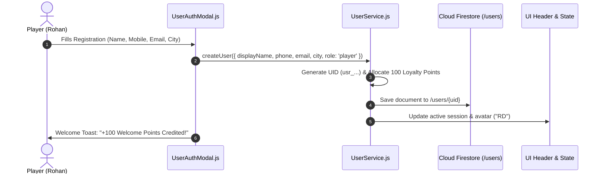
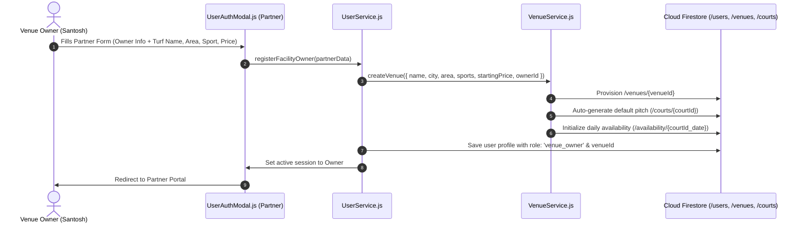
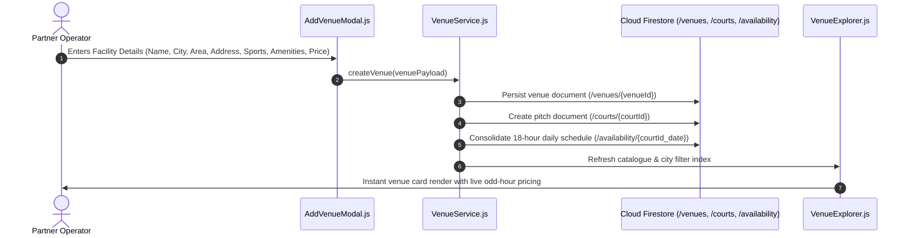

# Technical Architecture Plan: Project Apex
**Mission Slug:** `001-project-apex-mvp`  
**Governing Agents:** `apex-pm`, `apex-backend`, `apex-database`, `apex-ba`  
**Status:** Approved for Implementation & Production Verification  

---

## 1. System Architecture Overview
Project Apex operates under a serverless-client architecture strictly bounded by the **Firebase Spark (Free) Tier**.

```
+-----------------------------------------------------------------------------------------+
|                                      CLIENT TIER                                        |
|  [PWA Mobile/Web Shell] <------> [Local IndexedDB Cache & Service Worker (sw.js)]       |
|         |                                      |                                        |
|  [Slot Grid UI (06:00-24:00)]         [Venue Explorer & Filter]                         |
|  [Checkout Modal (5m Timer)]          [Gate Scanner & Walk-In Engine]                   |
|         |                                      |                                        |
|  +--------------------------+         +-------------------------------+                 |
|  | Concurrency Service      |         | Pricing Engine & Discounts    |                 |
|  | (5-min Lease check-&-set)|         | (Odd-hour bands, THANE50)     |                 |
|  +--------------------------+         +-------------------------------+                 |
|         |                                      |                                        |
|  [Client-Side Atomic Firestore Transactions: runTransaction(db, async (tx) => ...)]     |
+-----------------------------------------------------------------------------------------+
                                           |
                          (Zero Cloud Functions / No Node Server)
                                           |
                                           v
+-----------------------------------------------------------------------------------------+
|                                  FIREBASE SPARK TIER                                    |
|  [Firebase Hosting]           --> Global CDN Distribution & Static Asset Delivery       |
|  [Cloud Firestore]            --> 8 Collections Architecture (Aggregated Daily Docs)    |
|  [Firestore Security Rules]   --> Server-Side Integrity & Auth Defense                  |
+-----------------------------------------------------------------------------------------+
```

---

## 2. Spark Tier Constraint Optimization Protocol

### 2.1 The Read Quota Bottleneck (50,000 Reads/Day)
If each slot (24 slots per court) were stored as an individual subcollection document, loading 1 day for 20 courts would consume `20 * 24 = 480` reads per page load. Just 100 page views would wipe out the entire daily quota (48,000 reads)!

**The Read Minimization Solution:**
- **Consolidated Daily Document:** We aggregate all slots for a court into a single document:
  `availability/{courtId}_{YYYY-MM-DD}`.
- Document Schema:
  ```json
  {
    "courtId": "court_thane_01_crk",
    "venueId": "venue_thane_01",
    "date": "2026-11-20",
    "slots": {
      "06:00": { "slotTime": "06:00", "status": "AVAILABLE", "basePrice": 800, "isOddHour": true, "discountPct": 20 },
      "12:00": { "slotTime": "12:00", "status": "AVAILABLE", "basePrice": 1000, "isOddHour": true, "discountPct": 35 },
      "19:00": { "slotTime": "19:00", "status": "BOOKED", "bookingId": "bk_88291", "userId": "usr_991" }
    },
    "lastUpdated": 1795000000
  }
  ```
- **Read Reduction Impact:**
  - Checking a full day's court schedule = **1 single document read**.
  - 20 courts for 1 day = 20 reads.
  - Adding IndexedDB 15-minute TTL caching on the client reduces repeated reads by 80%.
  - 50,000 daily reads easily sustains over 10,000 daily active player sessions!

---

## 3. Concurrency Lock & Race Condition Architecture (Zero Cloud Functions)

### 3.1 Check-and-Set Concurrency Lock
We use a dedicated collection `concurrency_locks/{courtId_date_slot}`.
When a user clicks an available slot:
1. `runTransaction` reads `concurrency_locks/{lockId}`:
   ```javascript
   const lockRef = doc(db, 'concurrency_locks', `${courtId}_${date}_${slot}`);
   await runTransaction(db, async (transaction) => {
     const lockDoc = await transaction.get(lockRef);
     const now = Date.now();
     if (lockDoc.exists()) {
       const lockData = lockDoc.data();
       if (lockData.expiresAt > now && lockData.userId !== currentUserId) {
         throw new Error("SLOT_LOCKED_BY_ANOTHER_PLAYER");
       }
     }
     // Acquire 5-minute lease
     transaction.set(lockRef, {
       courtId,
       date,
       slot,
       userId: currentUserId,
       lockedAt: now,
       expiresAt: now + (5 * 60 * 1000), // 5 min TTL
       status: 'HELD'
     });
   });
   ```
2. During the 5-minute window, other users see the slot marked as `RESERVED / CHECKING OUT`.
3. If the user completes payment, the final booking commit transaction atomically:
   - Validates that the lock is still owned by `currentUserId`.
   - Creates the `bookings` record with `CONFIRMED` status.
   - Updates `availability/{courtId_date}` marking `slots[slot].status = 'BOOKED'`.
   - Records `transactions` and `audit_logs`.
   - Sets `concurrency_locks.status = 'COMMITTED'`.
4. If checkout is abandoned or times out, the lock expires automatically (`expiresAt < now`) without requiring any cleanup cron job.

---

## 4. End-to-End Core Business Workflows Architecture

### 4.1 Workflow 1: User (Player) Registration Flow & Loyalty Allocation


### 4.2 Workflow 2: Facility Owner Registration & Facility Auto-Provisioning


### 4.3 Workflow 3: Adding / Onboarding New Facilities & Pitch Schedules


### 4.4 Workflow 4: Slot Reservation, Concurrency Lock & Atomic Booking Commit
```mermaid
sequenceDiagram
    autonumber
    actor Player as Player
    participant UI as SlotCalendar.js & CheckoutModal.js
    participant CS as ConcurrencyService.js
    participant BS as BookingService.js
    participant DB as Cloud Firestore (/concurrency_locks, /bookings, /availability)

    Player->>UI: Selects available slot (e.g. 19:00 Friday)
    UI->>CS: acquireLock({ courtId, date, slot, userId })
    CS->>DB: Transaction: Set lease with 5-min TTL (status: HELD)
    CS-->>UI: Lock lease confirmed; Start 5:00 countdown timer
    Note over Player, UI: Concurrently, another player clicking same slot gets rejected
    Player->>UI: Selects payment method (UPI/Card) & Clicks "Pay & Confirm"
    UI->>BS: commitBooking(bookingContext)
    BS->>DB: Atomic Multi-Doc Transaction:
    Note over BS, DB: 1. Verify lock lease ownership<br/>2. Create /bookings/{bookingId} (CONFIRMED)<br/>3. Update /availability/{courtId_date} slot to BOOKED<br/>4. Write /transactions & /audit_logs<br/>5. Set /concurrency_locks status to COMMITTED
    BS-->>UI: Return confirmed booking & QR Pass Token
    UI->>Player: Render BookingConfirmation.js with Scannable QR Ticket
```

### 4.5 Workflow 5: Facility Owner Gate Check-In & Walk-In Reservation
- **Gate QR Pass Check-In:**
  - Owner / Gate attendant enters or scans player's QR token (e.g. `APEX-TH-CRK-10992`).
  - `BookingService.checkInPlayer(token, actorId)` validates booking status.
  - Transitions status from `CONFIRMED` -> `CHECKED_IN`, records `checkedInAt` timestamp, and appends gate audit log.
  - If token was already checked in, flags: `Player was already checked in at HH:MM`.
  - If booking was cancelled, rejects entry.
- **Walk-In Reservation Engine:**
  - Owner clicks "+ Walk-In Reservation" in `VenueOwnerPortal.js`.
  - Form selects pitch, date, time slot, customer name, mobile, sport, cash collected amount.
  - `BookingService.createWalkInBooking(...)` atomically verifies slot is not already booked, creates confirmed booking with `source: 'walk_in'`, updates daily availability document, and logs cash receipt in transactions ledger without online collision.

### 4.6 Workflow 6: 3-Tier Fair Cancellation & Automated Refunds
- **Fair Cancellation Matrix:**
  - **Tier 1 (> 24 hours notice):** 100% refund (minus ₹50 payment gateway handling fee).
  - **Tier 2 (6 - 24 hours notice):** 50% refund.
  - **Tier 3 (< 6 hours notice):** 0% refund (slot surrendered, venue compensated).
  - **Rainout / Force Majeure:** 100% platform credit refund.
- **Atomic Rollback:**
  - When player cancels via `PlayerPortal.js`, `CancellationService.cancelBooking(bookingId, userId)`:
    1. Sets booking status to `CANCELLED`.
    2. Restores slot in `availability/{courtId_date}` back to `AVAILABLE`.
    3. Clears concurrency lock lease.
    4. Generates refund transaction record in `transactions` collection.
    5. Appends cancellation event to `audit_logs`.

---

## 5. Technology Stack & Verification Architecture
- **Frontend Core:** Mobile-first responsive Progressive Web Application (PWA).
- **Styling:** Modern Tailwind CSS with dark/light themes, sports stadium accents, crisp typography.
- **Iconography:** Lucide Icons & Unicode emoji indicators.
- **Data & Auth:** Firebase Client SDK v10 (Firestore, Authentication, Hosting).
- **Offline Resilience:** Service Worker Cache API (`sw.js`) + IndexedDB (`offlineStorage.js`).
- **Automated Verification:** 64 automated integration tests across 7 test suites (`tests/runner.js`).
- **Interactive UI Demonstrator:** `ScenarioRunnerModal.js` providing real-time UI execution of all 6 workflows.
- **Orchestration Tooling:** Spec Kitty CLI (`spec-kitty`) & Multi-Agent Orchestrator CLI (`orchestrator/orchestrator.js`).
